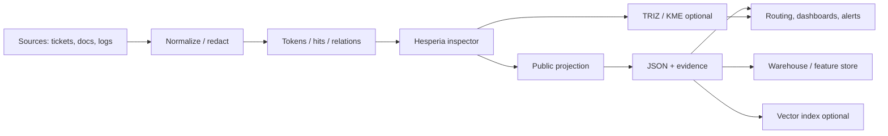

<!--
HESPERIA — Reference Architecture Definition (RAD)
Copyright © 2026 igareosh.com — Platonov Igor (aka @igareosh). All rights reserved.
Restricted Research Disclosure License. Inspection and reference only.
See LEGAL_NOTICE.md for full terms.
-->

# Hesperia — system awareness (for agents & developers)

**Single page for “what the system is end-to-end.”** Synthesized from RAD archive + deep research (2026-03-18). **Full narrative:** [research/HESPERIA_RAD_DEEP_RESEARCH_2026-03-18.md](research/HESPERIA_RAD_DEEP_RESEARCH_2026-03-18.md).

**Dynamics (target math, phased implementation):** [specs/dynamics/ETHAN_SEMANTIC_FIELD_DYNAMICS_SPEC.md](../specs/dynamics/ETHAN_SEMANTIC_FIELD_DYNAMICS_SPEC.md) — **L0–L10** full wire; **H0–H9**; Phase 1 = minimal L0+L2+L6+area contradiction+L9. **Calibration by design:** [specs/dynamics/HESPERIA_DYNAMICS_CALIBRATION_SPEC_v0_1.md](../specs/dynamics/HESPERIA_DYNAMICS_CALIBRATION_SPEC_v0_1.md) (bounded params, constraint-first, layered search, named release profiles).

**Hesperia Engine Dynamics v0.5 (canonical release):** [HESPERIA_v0_5_ENGINE_DYNAMICS.md](HESPERIA_v0_5_ENGINE_DYNAMICS.md) · [release note](../specs/release/HESPERIA_v0_5_ENGINE_DYNAMICS_RELEASE.md)

**Technical maps:** [HESPERIA_REPOSITORY_MAP.md](HESPERIA_REPOSITORY_MAP.md) · [HESPERIA_DEPENDENCY_GRAPH.md](HESPERIA_DEPENDENCY_GRAPH.md) · [HESPERIA_PRODUCT_STACK_MAP.md](HESPERIA_PRODUCT_STACK_MAP.md) · [HESPERIA_VARIABLE_CATALOG.md](HESPERIA_VARIABLE_CATALOG.md) · [HESPERIA_PRODUCT_LINES.md](HESPERIA_PRODUCT_LINES.md)

---

## One-sentence definition

> **Hesperia is a deterministic structural placement engine:** it maps **text** (and optionally an **active concept graph**) into **stable operational classes** (10 macro domains, 240 policy families in public outputs), with **evidence**, **trust/governance signals**, and **public-safe projection** — not generative “AI,” not a truth verifier.

---

## What to build toward (product boundary)

| In scope | Out of scope (non-claims) |
|----------|---------------------------|
| Repeatable placement + drift-friendly vectors | Proof of factual truth |
| Evidence traces for audit | Replacement for expert judgment in high-stakes use |
| Sealed runtime + **mandatory projection** before any public JSON | Leaking reserved indices (10+2 areas, 48 reserved families) |
| Topology-aware propagation (icosahedral 12-node graph, degree 5) | “Objective reality” from structural scores |

**TFP / clinical layer:** treated as **domain plug-in & test collateral** for psychodynamic ontology — **not** the generic definition of “Hesperia” for all markets. See `research/clinical_tfp/`, session topology E2E.

---

## Core public outputs (mental model)

- **Macro-domain vector** + **policy-family counts** (fixed lengths in public projection).
- **Dominants** (area/family) + propagated variants.
- **Scalars:** entropy, coverage, tension, loopability, confidence-style metrics.
- **Trust tier** + **evidence entries** (span, label, confidence band, location).
- **Extensions:** KME fingerprint (41 signals), TRIZ contradiction/innovation/narrative metrics — see [TRIZ_LIMITATIONS.md](TRIZ_LIMITATIONS.md).

---

## Execution Flow capability stack (non-TFP)

1. Attribution & coverage  
2. Traversal / activation structure (loops, reach)  
3. Shadow / correction vs baseline  
4. Topology & propagation over fixed adjacency  
5. Math gates & dynamism (stability, trajectory)  
6. Trust & governance (decision status, guards)  
7. Interpretation flags for downstream packaging  

**TRIZ:** decision-intelligence overlay (contradictions, Louvain-style clusters, narrative propagation) — **paid/extension** posture until ROI proven.

---

## Integration pattern (how buyers use it)

Treat Hesperia as a **bounded inspection microservice** + **batch feature generator**, not a monolith platform.

**Workflow patterns:** triage + escalation (trust threshold), drift monitoring (vector vs baseline), compliance manifests (version, checksum, evidence count).

---

## Deployment surfaces (archive-aligned)

- **Sealed CLI** — air-gapped / evaluator drops.  
- **Container HTTP API** — Bearer auth, OpenAPI-described.  
- **Contracts:** OpenAPI + JSON Schema; **schema version bumps** for any breaking public change.

---

## Development KPIs (what “good” means)

| KPI | Intent |
|-----|--------|
| Determinism rate | Same raw_text+config → same hash |
| Coverage | Matched vs total tokens |
| Evidence usefulness | Reviewer acceptance of top-k evidence |
| Automation eligibility | % above trust threshold (per tenant) |
| Schema stability | Rare version bumps |
| Latency | p50/p95 per document |

---

## Risk posture (short)

- **API:** authz, rate limits, payload caps (OWASP API Security–style).  
- **Leakage:** projection mandatory; no reserved indices in public artifacts.  
- **Regulatory:** EU AI Act / GDPR / HIPAA depend on **use case** — classify by deployment, not marketing label.  
- **Ethics:** misclassification with false confidence → use trust tier as **control surface**; human review in sensitive domains.

---

## Prioritized GTM (from research)

1. Software / security ops (incident text, triage).  
2. Industrial quality / manufacturing narratives.  
3. Regulated docs (healthcare, public sector) after governance maturity.

---

## Differentiation vs adjacent tech

Hesperia competes on **determinism + sealed projection + topology-aware structural metrics + evidence**, not on training custom classifiers or owning the full ontology platform. Full comparison table: [research file § competitive](research/HESPERIA_RAD_DEEP_RESEARCH_2026-03-18.md#competitive-and-adjacent-technology-comparison).

---

## When you change code

1. **Public JSON** → run projection tests; bump schema version if contract changes.  
2. **Topology / core math** → treat as **frozen** unless coordinated with [TOPOLOGY_INVARIANTS.md](TOPOLOGY_INVARIANTS.md).  
3. **Lexicon / NLP** → primary **tuning** surface; expect downstream drift.  
4. **New endpoints** → OpenAPI + shipping exclusion rules per [AGENTS.md](../AGENTS.md) governance docs.

---

*Maintainers: align with **Engine Dynamics v0.5** ([HESPERIA_v0_5_ENGINE_DYNAMICS.md](HESPERIA_v0_5_ENGINE_DYNAMICS.md)) and E2E contracts; deep-dive archive: `research/reports/HESPERIA_RAD_DEEP_RESEARCH_*.md`.*
