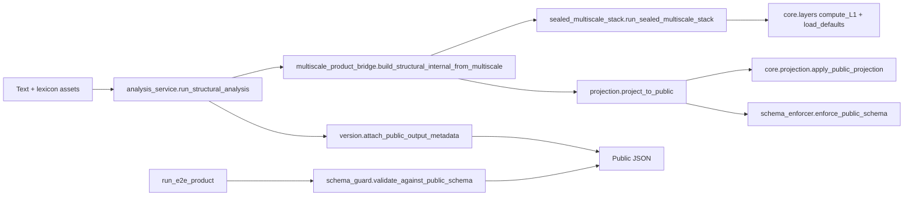

<!--
HESPERIA — Reference Architecture Definition (RAD)
-->

# Runtime execution spine (v0.5.0)

Debug-oriented map of **who calls whom** on the **canonical product path** and where **legacy sphere L1–L9** still appears (E2E / dev only).

## 1. Canonical product path (shipping truth)

**Entry (CLI / product E2E):**

| Step | Component | Symbol | Notes |
|------|--------|--------|--------|
| 1 | `runtime.pipeline.run_e2e_product` | `main()` | Or `runtime.pipeline.run_e2e_full_stack` → `_write_product_surface` |
| 2 | `runtime.services.analysis_service` | `run_structural_analysis()` | Rejects non-`full` stages; no sphere profile orchestration |
| 3 | `hesperia.engine.multiscale_product_bridge` | `build_structural_internal_from_multiscale()` | Assembles **internal** layer-shaped dict |
| 4a | `hesperia.engine.sealed_multiscale_stack` | `run_sealed_multiscale_stack()` | Concept → hex → microphysics → family/area aggregates → product signals → HSPR |
| 4b | `hesperia.extensions.dynamics.e2e_bridge` | `markers_to_concept_activation()` | Shared token/concept path (also used inside sealed stack) |
| 4c | `core.layers` | `load_defaults()`, `compute_L1()` | **Partial:** defaults + L1-sized summary for envelope; **not** full L1–L9 sphere runner |
| 5 | `hesperia.engine.projection.public_projection` | `project_to_public()` | **Single product choke point** |
| 6 | `core.projection` | `apply_public_projection()` | Topology / vocabulary sanitization |
| 7 | `hesperia.engine.projection.schema_enforcer` | `enforce_public_schema()` | → `runtime.shipping.schema_guard.validate_public_schema_strict()` |
| 8 | `hesperia.system.version` | `attach_public_output_metadata()` | Version / calibration envelope (when `attach_version=True`) |
| 9 | `runtime.shipping.schema_guard` | `validate_against_public_schema()` | Product E2E: nested **key** guard before write |

**Schema files (contract):**

- Shape definition: `schemas/public/public_output_schema.json` (frozen copy: `schemas/public_api_v0_5_1.snapshot.json`; historical: `schemas/public_api_v0_5_0.snapshot.json`).
- Allowlist loader: `runtime.shipping.schema_guard.load_public_output_top_level_allowlist()` (optional strict mode via `HESPERIA_PUBLIC_SCHEMA_STRICT_KEYS`).

### Important correction vs “sphere.execution_flow”

On the **shipping** path, **`sphere.execution_flow.run_pipeline` is not invoked** (see `hesperia.engine.sealed_multiscale_stack` component docstring and `runtime.services.analysis_service` header).  
The **legacy icosahedral L1–L9 runner** exists for **dev / calibration / selected E2E** (e.g. when `HESPERIA_SPHERE_PIPELINE_DEV=1` or via `runtime.pipeline.analyze` — the latter is **excluded** from import-boundary scans by policy).

## 2. Thin CLI wrapper (same canonical stack)

| Component | Role |
|--------|------|
| `runtime.pipeline.run_l1_through_l9` | `run_pipeline_for_text()` → `run_structural_analysis(..., stages="full")` then sets `run: L1_through_L9` for contract compatibility |

## 3. Internal E2E paths (not the minimal product proof)

| Flow | Entry | Notes |
|------|-------|--------|
| Sentence analyze + projection | `runtime.pipeline.analyze.analyze` → `core.projection.apply_public_projection` | R1–R4 and extended minimal payloads |
| L1–L9 JSON artifact | `runtime.pipeline.run_e2e_all.run_e2e_l1_l9` | Uses `run_l1_through_l9.run_pipeline_for_text` + optional `hex_outputs.e2e_integration`, then `apply_public_projection` |
| Sphere math batches | `runtime.pipeline.run_sphere_math_values` / `run_sphere_math_100_sentences` | Touches `sphere.*` numerics for calibration-style artifacts |

Use **§1** when debugging **product / API / `run_e2e_product`**. Use **§3** when debugging **calibration or legacy sphere math JSON**.

## 4. Related tooling

| Artifact | Purpose |
|----------|---------|
| `docs/IMPORT_GRAPH_v0_5_0.md` | Static imports under `runtime/*` + `runtime/services` (CI diff) |
| `docs/IMPORT_GRAPH_ENGINE_v0_5_0.md` | Static imports under `hesperia/engine/` (CI diff) |
| `tools/check_import_boundary.py` | Hard **forbidden** import list for public runtime |
| `tools/check_forbidden_zone_imports.py` | No `research.*` / `legacy.*` in strict trees (see tool docstring) |
| `tools/validate_shipping_surface.py` | Explicit allowlist for `runtime/shipping/*.py` |
| `tools/audit_shipping_allowlist.py` | Every allowlist prefix is used; optional creep cap (`--strict-unused`) |
| `tools/check_dead_weight_budget.py` | Absolute cap + drift vs `RECORDED_COUNT` (`MAX_INCREASE_FROM_RECORDED`) in `docs/DEAD_WEIGHT_BASELINE.txt` |
| `tools/check_engine_projection_boundary.py` | `hesperia/engine/**` may import `core.projection*` only under `hesperia/engine/projection/` |
| `tests/test_runtime_spine_integrity.py` | Spine import + smoke; **exclusive path** counts (`run_sealed_multiscale_stack` via bridge, `apply_public_projection`, no `sphere.execution_flow`) |
| `tests/test_semantic_output_signature.py` | Public JSON semantic contract + magnitude bounds |
| `tests/test_guard_invariants_locked.py` | Substring locks on critical tools/contracts (anti test-weakening) |
| `schemas/public_api_v0_5_1.snapshot.json` | Byte-identical freeze of public output JSON Schema (v0.5.1 line) |
| `tools/find_unreferenced_files.py` | Heuristic unreachable modules from `runtime`+`tests` BFS |

See also **`docs/VERSIONING_GATE_v0_5_1.md`** for when a version bump is allowed to change E2E bytes.
