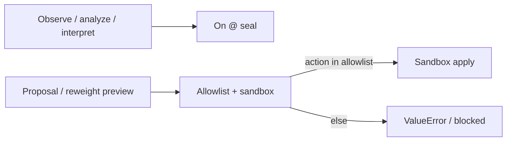

# Apply allowlist @ 0.7.0 (H070)

**Status:** LIVE structure hub (hand-authored)  
**Wave:** HWIKI-STRUCT-08  
**Seal:** `v0.7.0` — observe/propose ≠ unrestricted mutate

[← wiki home](../index.md) · [How it works](HOW-IT-WORKS-0.7.0.md) · [System structure](SYSTEM-STRUCTURE-0.7.0.md)

---

## One sentence

Graph **apply** exists under **0.7.0 allowlist gates** — seal shipped measurement + interpret; it did **not** open unrestricted graph mutation.

---

## Scheme



## VERSION.yaml apply block (verified)

```yaml
apply:
  version: "0.7.0"
  gate_chain: "G1-G9"
  allowlist:
    - update_edge_weight
  phase2_allowlist:
    - add_edge
```

| Field | Meaning |
|-------|---------|
| `allowlist` | Actions legal for first molt — currently **`update_edge_weight` only** in executor |
| `phase2_allowlist` | Declared future (`add_edge`) — not the live `ALLOWED_ACTIONS` set |
| `gate_chain` | `G1-G9` acceptance chain (research/gates docs) |

## Code anchors

| Piece | Path |
|-------|------|
| Executor | `runtime/h070_apply/executor.py` — `ALLOWED_ACTIONS = frozenset({"update_edge_weight"})` |
| Sandbox diff | `runtime/h070_apply/sandbox.py` (via executor import) |
| Identity | root `VERSION.yaml` `apply:` block |

Non-allowlisted `action` → `ValueError("action not allowlisted: …")`.

## Wiki rule

When citing apply: say **allowlist-gated**, not “apply impossible forever” (0.6.3 `applied=0` language is historical observe-only framing).

SIGNED: Researcher (Colombo) + Cursor proceed | HWIKI-STRUCT-08 apply allowlist | 2026-07-26 | v0.7.0
