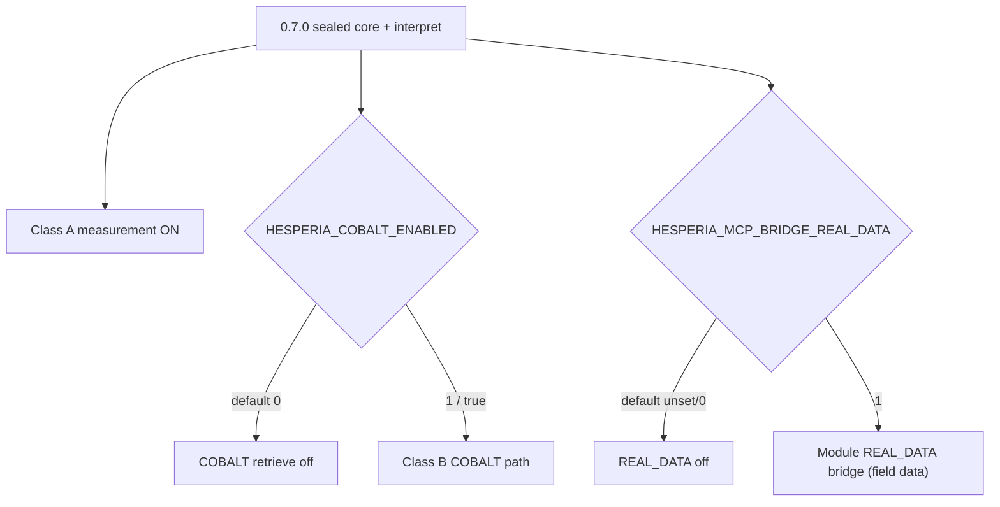

# COBALT-off and REAL_DATA gates @ 0.7.0

**Status:** LIVE structure hub (hand-authored)  
**Wave:** HWIKI-STRUCT-09  
**Seal:** `v0.7.0` — Class B attribution / module REAL_DATA remain gated  
**Identity:** Multipurpose engine — [ETHAN-HESPERIA-MULTIPURPOSE-ENGINE-IDENTITY.md](../../../../governance/ETHAN-HESPERIA-MULTIPURPOSE-ENGINE-IDENTITY.md) (not clinical/medicine)

[← wiki home](../index.md) · [System structure](SYSTEM-STRUCTURE-0.7.0.md) · [Class A/B hub](../CLASS-AB-SCIENCE-NARRATIVE-HUB.md)

---

## One sentence

**COBALT** (library attribution / CHROMA-2 retrieve) and **REAL_DATA** (module field-data bridge flags) stay **off by default** after the 0.7.0 seal — flip only under separate Grace / operator gates. Flag names may say “clinical” in legacy code — that is a **label**, not Hesperia product identity.

---

## Scheme

## COBALT

| Item | Verified |
|------|----------|
| Flag | `HESPERIA_COBALT_ENABLED` default **`"0"`** |
| Code | `runtime/cobalt/flags.py` → `cobalt_enabled()` |
| Class | **B** (attribution / library) — must not fold into sealed `/analyze` |
| Seal note | Ethan castle: COBALT prod flag stays 0 |

Consumers may import `cobalt_enabled` (e.g. `product_interpret_service`, IRC adapter) — presence ≠ enabled.

## REAL_DATA

| Item | Verified |
|------|----------|
| Flag | `HESPERIA_MCP_BRIDGE_REAL_DATA` (docs/specs; not flipped by seal) |
| Policy | Specs forbid casual `REAL_DATA=1` until COBALT corpus scale-up exits |
| Seal note | Module REAL_DATA still gated — separate Grace gates; **not** “Hesperia is clinical” |

## Wiki rule

Document these as **gates**, not as dead science. When writing Class B narratives, link here so agents do not assume library retrieval or module field REAL_DATA are on in prod — and do not equate REAL_DATA with “Hesperia = medicine.”

SIGNED: Researcher (Colombo) + Cursor proceed | HWIKI-STRUCT-09 COBALT/REAL_DATA | 2026-07-26 | v0.7.0
