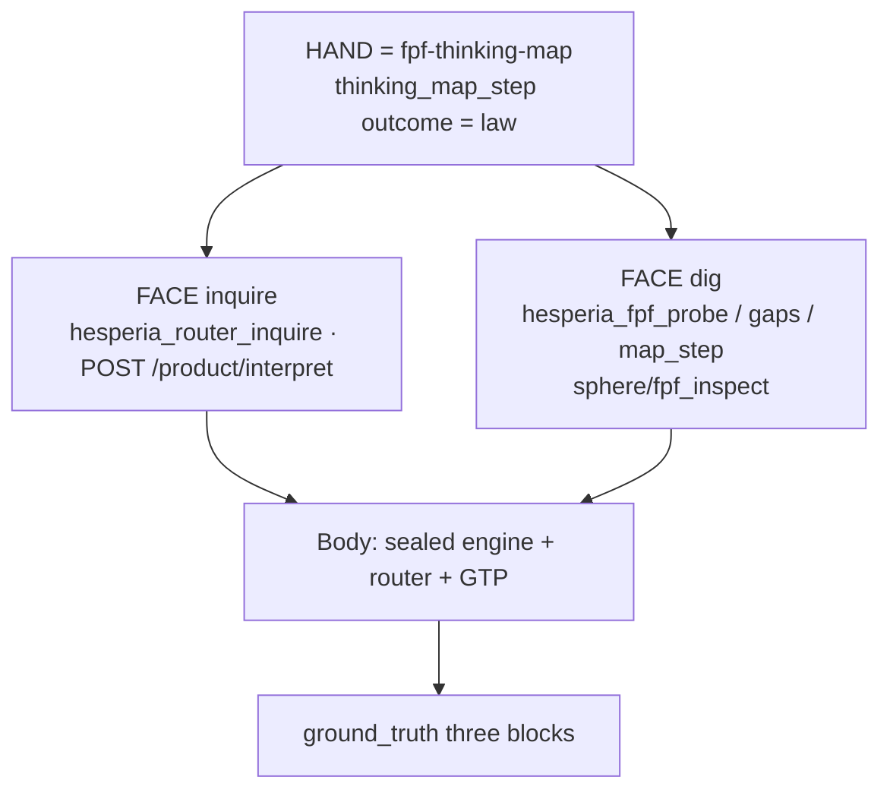

# HAND faces @ 0.7.0

**Status:** LIVE structure hub (hand-authored)  
**Wave:** HWIKI-STRUCT-07  
**Seal:** `v0.7.0`  
**Canon:** [SPEC-ETHAN-HESPERIA-FPF-HAND-AGENT-ROLLING.md](../../../../governance/SPEC-ETHAN-HESPERIA-FPF-HAND-AGENT-ROLLING.md)

[← wiki home](../index.md) · [System structure](SYSTEM-STRUCTURE-0.7.0.md) · [How it works](HOW-IT-WORKS-0.7.0.md)

---

## One sentence

**fpf-thinking-map is the lawful HAND; Hesperia is the sealed body.** Agents move via map outcome JSON; the body answers with engine-authored **ground_truth** (logical / weight / source_activation) — narrative LLM never becomes the answer.

---

## Faces under one HAND

| Face | What it is for | Code / MCP anchors |
|------|----------------|--------------------|
| **Inquire (act/roll)** | Product interpretation above sealed measurement | `POST /product/interpret` · `runtime/services/product_interpret_service.py` · `sphere/router/*` · MCP `hesperia_router_inquire` |
| **Dig (inspect)** | Bottom-up inspect / gaps — not the same tool as inquire | `sphere/fpf_inspect/*` · MCP `hesperia_fpf_probe` / gaps / map_step |
| **Ground truth** | Engine-authored evidence attached to agent-facing answers | `sphere/router/ground_truth.py` · `derive_ground_truth_blocks` |

**Forbidden:** merging dig and inquire into one blurred MCP; agent-authored ground_truth blocks; treating chat re-derivation as Move law.

---

## Pin note @ seal

| Surface | Pin |
|---------|-----|
| Hesperia product (0.7.0 seal) | fpf-thinking-map **1.9.2** (castle report) |
| Brain soak | may track **1.9.3** — documented diverge; do not silently equate |

`VERSION.yaml` component `fpf_bridge: v7.2-v7.4` — sealed with 0.7.0; flag-gated modules remain opt-in.

SIGNED: Researcher (Colombo) + Cursor proceed | HWIKI-STRUCT-07 HAND faces | 2026-07-26 | v0.7.0
