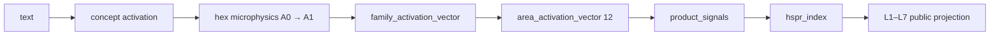
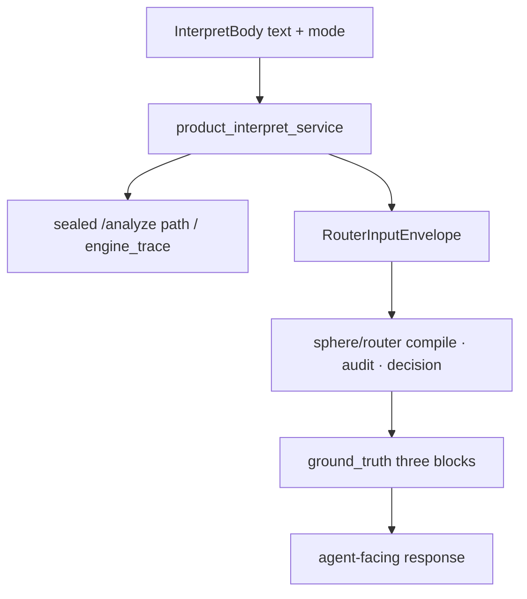

# How Hesperia works @ 0.7.0

**Status:** LIVE how-it-works hub (hand-authored)  
**Wave:** HWIKI-STRUCT-03  
**Seal:** `v0.7.0`  
**Companion:** [System structure](SYSTEM-STRUCTURE-0.7.0.md)

[← wiki home](../index.md) · [Coverage Ledger](../Coverage-Ledger.md)

---

## Rule

**Name the plane before reasoning.** Sealed `/analyze`, product `/product/interpret`, legacy guard pipeline, and sphere-dev pipeline are **different** execution surfaces. Mixing their outputs invents false science.

---

## Plane A — Sealed multiscale (production measurement)

**Entry:** `POST /analyze` → `runtime/services/analysis_service.py` → `hesperia/engine/sealed_multiscale_stack.py`  
**Module docstring (verified):** concept hits → hex → local microphysics → family bridge → area → product signals → HSPR → public projection.

**What this plane is:** deterministic **measurement** on the semantic grid.  
**What it is not:** graph apply; Nash settlement; Class B domain narrative as core physics; medicine/clinical product; an LLM with built-in knowledge.  
**Identity:** [ETHAN-HESPERIA-MULTIPURPOSE-ENGINE-IDENTITY.md](../../../../governance/ETHAN-HESPERIA-MULTIPURPOSE-ENGINE-IDENTITY.md)

Wiki symbols that live on this path include tension / entropy / fusion / threshold pages under Geometry, Core Math, Propagation, Activation — look up via MCP `query_hesperia_wiki` / `get_hesperia_wiki_page`.

---

## Product interpret — composition above Plane A

**Entry:** `POST /product/interpret` → `runtime/services/product_interpret_service.py` (builds router envelope from sealed analyze path) → `sphere/router/*`.

### Ground-truth doctrine (mandatory)

From `sphere/router/ground_truth.py` (FPF-HSR-13): every agent-facing response on this seam must carry three **engine-authored** blocks — never optional omit:

| Block | Role |
|-------|------|
| **logical** | engine_trace / logic_mapping / GTP imprint sides |
| **weight** | governance, loopability, tension_energy, obstacle_score, risk |
| **source_activation** | corpus/policy snapshots, retrieval, GTP hex |

Seams that inherit this: HTTP `/product/interpret` and `sphere/router/tool_inquiry.py` (CLI / hesperia-router MCP).

---

## Observe vs apply (0.7.0 boundary)

| Action | Status @ seal |
|--------|----------------|
| Measure / analyze | **On** — sealed stack |
| Interpret / router compose | **On** — `/product/interpret` |
| Preview reweight / proposals | Observe/propose patterns remain; see H070 research |
| **Mutate governed graph (apply)** | **Allowlist-gated** — seal did not open unrestricted apply |
| COBALT prod · module REAL_DATA | **Still gated** (separate Grace gates) |

Do not cite 0.6.3 “applied=0 forever” as if apply were impossible forever — cite **allowlist gate** instead.

---

## Other planes (awareness only)

| Plane | Entry | Use in 0.7.0 wiki |
|-------|--------|-------------------|
| Legacy guard ΣΓΘ | `runtime/pipeline/analyze.py` → `guard_pipeline.py` | Historical / narrow; not primary shipping story |
| Sphere-dev | `sphere/pipeline/pipeline_runner.py` + `HESPERIA_SPHERE_PIPELINE_DEV=1` | Dev/tests; sealed docstring marks legacy sphere path as non-shipping |
| L3 attribution shadow | `core/layers/layer_3.py` | Distinct from sphere L8 field correction |

Detail inventory: [NASH how-it-works](../../NASH_research/NASH_research_HESPERIA-HOW-IT-WORKS.md) — re-verify before citing numbers older than seal.

---

## Operator / agent lookup path

1. Structure question → this file + [SYSTEM-STRUCTURE-0.7.0.md](SYSTEM-STRUCTURE-0.7.0.md)  
2. Symbol live/dead → parameter wiki MCP / `pages/`  
3. Class A vs B placement → [CLASS-AB-SCIENCE-NARRATIVE-HUB.md](../CLASS-AB-SCIENCE-NARRATIVE-HUB.md)

SIGNED: Researcher (Colombo) | HWIKI-STRUCT-03 how-it-works | 2026-07-26 | v0.7.0
