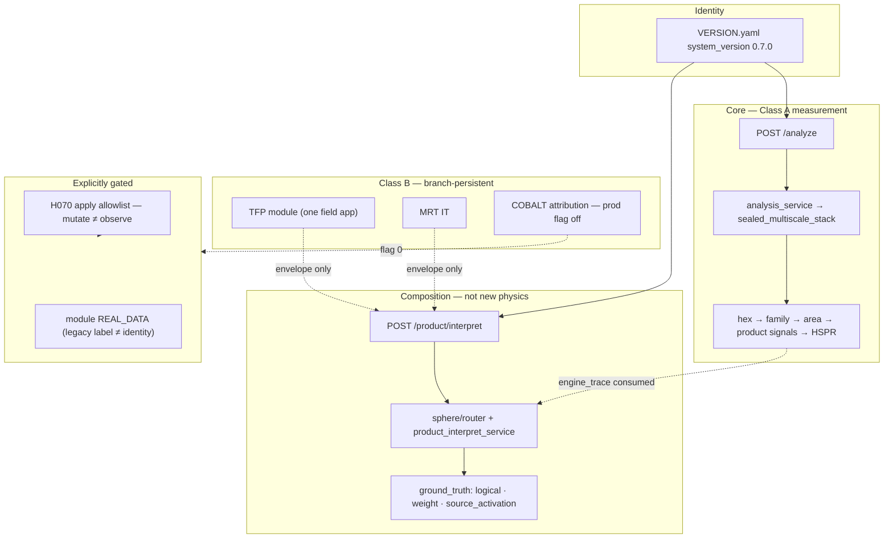

# Hesperia system structure @ 0.7.0

**Status:** LIVE structure hub (hand-authored; not a parameter ITEMS page)  
**Wave:** HWIKI-STRUCT-02  
**Seal:** `system_version 0.7.0` · `release_stage: modular_branches` · tag `v0.7.0`  
**Verified:** `/data/hesperia/hesperia` and `/data/workspaces/atomic-commit-hesperia` `VERSION.yaml` (2026-07-26)

[← wiki home](../index.md) · [How it works](HOW-IT-WORKS-0.7.0.md) · [Class A/B hub](../CLASS-AB-SCIENCE-NARRATIVE-HUB.md) · [Coverage Ledger](../Coverage-Ledger.md)

---

## One sentence

**Hesperia 0.7.0** is a **multipurpose sealed runtime semantic engine** (dictionaries · logic · areas/families · grid measurement) plus **modular branches** and a **V7 router composition layer** (`/product/interpret`) — not a single pipeline, not an LLM, not a clinical/medicine product, and not an open graph editor.

**Identity:** [ETHAN-HESPERIA-MULTIPURPOSE-ENGINE-IDENTITY.md](../../../../governance/ETHAN-HESPERIA-MULTIPURPOSE-ENGINE-IDENTITY.md)

---

## Layers (do not merge)

---

## What each layer is for

| Layer | Answers | Code anchors (0.7.0) |
|-------|---------|----------------------|
| **Core /analyze** | Where does this text land on the semantic grid, deterministically? | `runtime/shipping/api_main.py` `POST /analyze` · `runtime/services/analysis_service.py` · `hesperia/engine/sealed_multiscale_stack.py` |
| **Product interpret** | What structural / agent-facing interpretation sits *above* sealed measurement? | `POST /product/interpret` · `runtime/services/product_interpret_service.py` · `sphere/router/*` · `sphere/router/ground_truth.py` |
| **Class A modules** | Universal plumbing safe to consolidate into core | `dict_a` / `dict_b`, topology, nlp, metrics — see [CLASS-AB hub](../CLASS-AB-SCIENCE-NARRATIVE-HUB.md) |
| **Class B modules** | Domain/theme/attribution — must **not** fold into sealed `/analyze` | TFP · MRT · COBALT |
| **Apply (H070)** | May we mutate the governed graph? | Allowlist-gated; seal did **not** flip open apply |

---

## VERSION.yaml components (sealed identity)

| Component | Value @ seal |
|-----------|--------------|
| `core_engine` | `0.7.0` |
| `dynamics` / `triz` | `0.6.3` |
| `clinical` | `0.6.3-modular` — **component/module label in VERSION.yaml**, not “Hesperia is medicine” |
| `calibration` | `0.7.0` |
| `router` | `v7-router-0.1` |
| `fpf_bridge` | `v7.2-v7.4` (sealed; flag-gated modules remain opt-in) |

Pin note: brain thinking-map soak may track **1.9.3** while Hesperia product sealed with **1.9.2** — documented diverge in Ethan castle report; do not silently equate.

---

## Relation to the parameter wiki

- **Parameter pages** (`pages/*`) answer: is symbol X LIVE/DEAD, formula, module path.
- **This hub** answers: which *system layer* owns the path you are on.
- Cross-link: when a param is Class A vs B, prefer [CLASS-AB hub](../CLASS-AB-SCIENCE-NARRATIVE-HUB.md) + [TEMPLATES-DECISION-THEORY.md](../TEMPLATES-DECISION-THEORY.md).

Architecture canon: [HESPERIA-MODULAR-BRANCH-ARCHITECTURE.md](../../HESPERIA-MODULAR-BRANCH-ARCHITECTURE.md) §2 / §2c.

SIGNED: Researcher (Colombo) | HWIKI-STRUCT-02 system structure | 2026-07-26 | v0.7.0
