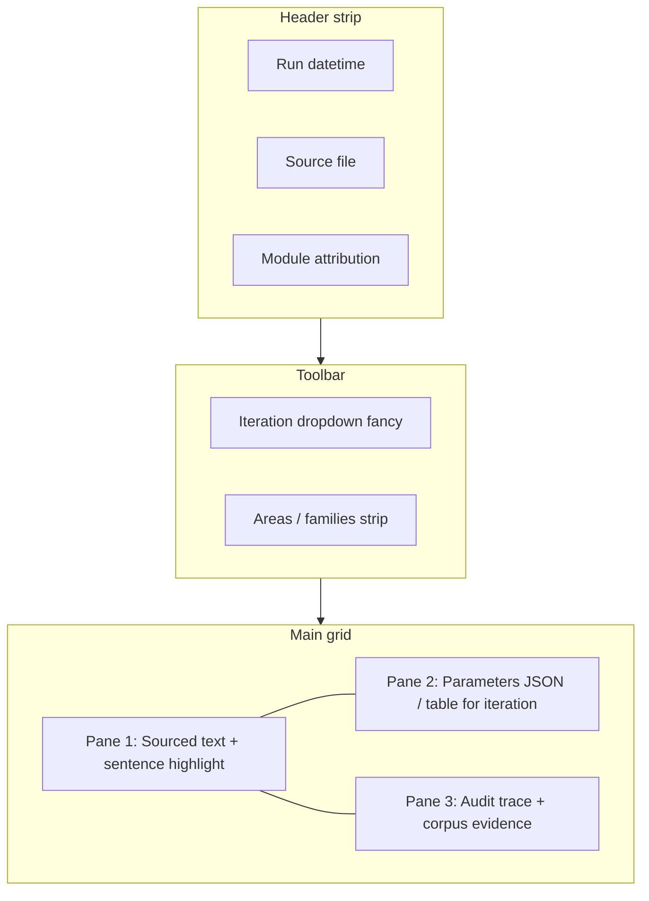

# Spec: Hesperia — single-page Session / Iteration Inspector (Ethan)

**Author:** Ethan (Chief Architect).  
**Purpose:** Specify **one** flagship **HTML output page** (“Session Inspector”) that lets operators (and later, gated clients) review **one full session** as **ordered iterations**, with **Cursor IDE–style** multi-pane layout, **sentence-level** drill-down into **parameters** and **source audit** evidence. This is the **product design contract** for Gena to implement under `output_views` (or Template B SPA if later split).

**Status:** Plan / UX + data contract. **Does not** change FastAPI JSON API semantics; the page consumes a **session bundle** (artifact or BFF-assembled JSON). **Grace** triages implementation rows.

**Refs:** [SPEC-ETHAN-HESPERIA-DJANGO-OUTPUT-VIEWS.md](SPEC-ETHAN-HESPERIA-DJANGO-OUTPUT-VIEWS.md), [SPEC-ETHAN-HESPERIA-OUTPUT-PREVIEW-DESIGN-TEMPLATES.md](SPEC-ETHAN-HESPERIA-OUTPUT-PREVIEW-DESIGN-TEMPLATES.md), brain `HESPERIA-TFP-YIELDED-PARAMETERS-TABLE.md`, `HESPERIA-TFP-RUNTIME-VARIABLES-TABLE.md`, Grace narrative on iteration vs session (brain operational reports).

**Grace tasking (same-day MVP + OpenAI segment):** [operational/assignments/GRACE-TASKING-ETHAN-OUTPUT-PAGE-KERNBERG-SEGMENT-2026-04-07.md](../operational/assignments/GRACE-TASKING-ETHAN-OUTPUT-PAGE-KERNBERG-SEGMENT-2026-04-07.md) — **45** tasks **T01–T45** for triage into `active.md`.

---

## 1. Scope — one page = one session

| Rule | Spec |
|------|------|
| **Session unit** | One **persisted run** (single analyze pass, E2E bundle slice, or future multi-turn pipeline export). The URL or route identifies **exactly one** `session_id` / `run_id`. |
| **Iteration unit** | Ordered list of **client-analytic iterations** (turn, segment, or window). Each iteration has **monotonic `order`** (0..n-1) and **timing fields** for future charts. |
| **Not in v1** | Editing text, re-running engine from this page, or writing calibration assets. **Read-only** inspection. |

---

## 2. Global header (always visible)

| Field | Source | Notes |
|-------|--------|-------|
| **Date / time of run** | Bundle `meta.run_timestamp_utc` (ISO-8601) + optional operator TZ display | Must be unambiguous (UTC stored, UI may show local). |
| **Name of source file** | `meta.source_file` or `meta.source_label` | Filename only in UI; full path optional tooltip (no secrets). |
| **Module attribution** | `meta.modules_executed[]` or `meta.module_versions` map | Which Hesperia modules contributed to this bundle (names + semver or hash). |

---

## 3. Iteration control — “fancy” windowed dropdown

| Requirement | Spec |
|-------------|------|
| **Control** | Single **primary selector** (combobox / mega-dropdown) listing **all iterations** for this session. |
| **Per entry label** | Short label: `Iteration {order}` + optional subtitle (e.g. first 40 chars of client text, or time range). |
| **Styling** | **Template A** alignment: dark pills, chevron, subtle hover/active states, optional **chip** for “current” iteration; keyboard navigable (↑↓, Enter, Esc). |
| **Behavior** | Changing selection **swaps** primary text + resets sentence selection unless deep-linked state restores selection. |

**Timing / order (for future graphs):** each iteration object **must** include:

| Key | Type | Purpose |
|-----|------|---------|
| `order` | int | Stable sequence for x-axis. |
| `t_start_ms` / `t_end_ms` | int, optional | Relative or absolute ms for duration / timeline charts. |
| `wall_clock_iso` | string, optional | When iteration was produced. |

If only `order` exists, graphs default to **ordinal** x-axis.

---

## 4. Mandatory analytic strip — areas & families

For the **active iteration**, always show (collapse allowed, not hide-by-default on first paint):

| Block | Content |
|-------|---------|
| **Areas involved** | List of `area_id` + **human function** (one line from ontology / dict B helper text) + **strength** (scalar from bundle). |
| **Families involved** | Same pattern for family keys (`F#` or composite). |
| **Relations** | Compact summary: **top edges** (e.g. area–family links, co-activation pairs) as text bullets or mini **relation chips**; v2 may swap to graph widget. |

Data comes from iteration-scoped `areas`, `families`, or `signals` in the bundle — **no** recomputation in the browser beyond formatting.

---

## 5. Main workspace — Cursor IDE–style three-pane layout

**Metaphor:** Editor area + side/bottom panels, **resizable** splitters (drag), **dark** chrome consistent with [Black Dashboard Django](https://github.com/creativetimofficial/black-dashboard-django) reference.



| Pane | Role | Interaction |
|------|------|-------------|
| **Pane 1 — Source / transcript** | Shows **full sourced text** for the active iteration (client-analytic primary text). Text is **segmented into sentences** (or engine-provided spans). | **Click or drag** to select a sentence → **highlight** active sentence; fires event `sentence_selected(sentence_id)`. |
| **Pane 2 — Parameters** | **All output parameters** for the **active iteration** (see §6). Default view: **collapsible tree** or **key-value table** synced to `HESPERIA-TFP-YIELDED-PARAMETERS-TABLE` fields where present. | On `sentence_selected`, **filter or scroll** to **sentence-scoped parameters** (`parameters_by_sentence[sentence_id]` or equivalent slice). If no per-sentence slice, show **iteration-level** params + **banner** “sentence-level projection not available.” |
| **Pane 3 — Source audit** | **Dynamic** content for **active sentence** (or iteration if no sentence): **top 3 attribution winners** (concepts / spans / scores) + **corpus paragraphs** (or snippet IDs + text) **proving** the attribution. | Updates on same `sentence_selected`; shows **empty state** when no audit trail exists. |

**Layout defaults:** Pane 1 **left 50%**; Pane 2 **right top 50%**; Pane 3 **right bottom** or **bottom full width** — implementer may offer **toggle preset** (IDE vs stacked mobile).

---

## 6. Parameter coverage (Pane 2 contract)

Map bundle keys to UI sections (minimum for **TFP-capable** sessions):

| Section | Keys (illustrative) |
|---------|---------------------|
| **Core vectors** | `tfp_vector`, `areas`, `families`, `metrics` |
| **TFP module** | `modules["tfp.v1"].tfp_profile`, `tfp_conflicts` |
| **Invariant path** (if present) | `invariant_activation` subtree, hex-related fields |
| **Trace** | `meta.trace` or iteration-local `trace` |

**Sentence-level overlay:** bundle SHOULD expose optional:

```json
"sentence_index": {
  "s3": { "concept_hits": [], "dlcr_spans": [], "scores": {} }
}
```

If absent, Pane 2 stays at iteration granularity; Pane 3 may still show audit if keyed by sentence elsewhere.

---

## 7. Audit trace (Pane 3 contract)

For **selected sentence** `sentence_id`:

| Block | Spec |
|-------|------|
| **Winners 1–3** | Ordered list: **label**, **score**, **source** (module / layer), **span** (char offsets into iteration text). |
| **Corpus proof** | 1–n **paragraphs** or **chunk references** with **verbatim excerpt** + **corpus id** (file / doc / offset). Read-only; link-out to internal doc viewer optional. |

**Provenance:** every winner row links to a **trace id** present in engine JSON if available (future graph: trace DAG).

---

## 8. Session bundle — transport shape (v1 target)

Implementer defines versioned JSON (`session_inspector_v1`) with minimum:

```json
{
  "version": "session_inspector_v1",
  "meta": {
    "run_timestamp_utc": "...",
    "source_file": "...",
    "modules_executed": ["core.dict_a", "tfp.v1"]
  },
  "iterations": [
    {
      "id": "it_0",
      "order": 0,
      "t_start_ms": 0,
      "t_end_ms": 1200,
      "label": "Client turn 1",
      "text": "Full sourced text...",
      "sentences": [{ "id": "s0", "start": 0, "end": 42, "text": "..." }],
      "parameters": { },
      "sentence_index": { },
      "audit_by_sentence": { }
    }
  ]
}
```

**Producer:** offline tool, E2E exporter, or Django BFF that **assembles** from existing engine outputs — **no second scoring**.

---

## 9. Ethan additions (worth shipping)

| Feature | Rationale |
|---------|-----------|
| **Deep links** | `?session=&iteration=&sentence=` for support and demos. |
| **Copy JSON** (current iteration) | Operator debugging. |
| **Diff mode** (phase 2) | Compare two iterations side-by-side. |
| **Virtualized transcript** | Performance for long sessions. |
| **a11y** | Focus order, ARIA on panes, reduced-motion respect. |
| **Auth** | LAN or login gate per deploy policy; never expose raw corpus to anonymous if corpus is restricted. |

---

## 10. Phased delivery

| Phase | Outcome |
|-------|---------|
| **P0** | Static **mock** bundle renders header + dropdown + three panes (fixture JSON). |
| **P1** | Wire **real** E2E / export JSON; iteration order + areas/families strip. |
| **P2** | Sentence segmentation + Pane 2 sentence filter + Pane 3 audit (requires bundle fields). |
| **P3** | Resizable panes, deep links, graph-export CSV of `(order, metric_key, value)`. |

---

## 11. Ownership

| Role | Responsibility |
|------|----------------|
| **Gena** | Django view + template/JS, bundle schema validator, tests. |
| **Ethan** | Amend spec if bundle shape changes. |
| **Abelard** | Route, TLS, static, auth proxy if needed. |

---

`SIGNED: Ethan (Chief Architect) | Hesperia Session Inspector page | 2026-04-07 | governance spec`
