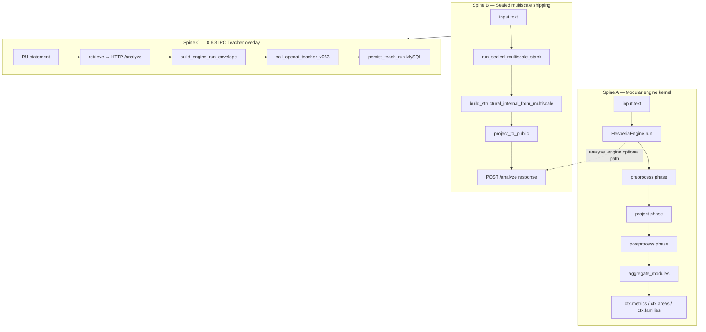

# Hesperia Description Object Investigation — Run 01 of 05

**Title:** Global architecture, iteration model, state machine, entry points, and 0.6.3 overlay  
**Version:** Hesperia 0.6.3 (description object investigation)  
**Product SHA (runtime):** `e9eaa07` · **Tag (archive):** `122d45b`  
**Index:** [HESPERIA-DESCRIPTION-OBJECT-INVESTIGATION-0.6.3-INDEX.md](HESPERIA-DESCRIPTION-OBJECT-INVESTIGATION-0.6.3-INDEX.md)

---

## Abstract

Hesperia at 0.6.3 exposes **two cooperating execution spines** on the product repository: (A) a **modular engine kernel** that iterates registered modules through three fixed phases over a guarded context, and (B) a **sealed multiscale structural stack** that maps lexical concept hits through hex microphysics to family, area, product signals, and HSPR — this spine is what **shipping** (`POST /analyze`) and the **0.6.3 IRC Teacher path** consume. Run 01 establishes the **global runtime grammar**: states, scopes, iteration indices, where outputs become downstream parameters, and what 0.6.3 adds without mutating the graph.

---

## 1. Investigation charter

### 1.1 Question

When Hesperia code runs on a single Russian TFP scientific statement, **what transforms in what order**, under which **scopes**, with which **concurrent** orchestration paths, and which **output fields** feed the next stage?

### 1.2 Method (academic practice)

1. **Inventory** — list verified Python entrypoints and configs on product tree (`e9eaa07`).
2. **Locate** — map files to roles; cite path + function/block; no invented modules.
3. **Formalize** — name states, phases, tensors, and envelope schemas.
4. **Example** — one minimal trace at macro level (detail in Run 05).
5. **Boundary** — separate 0.6.3 **observe → propose → store pending** from 0.7.0 graph apply.

### 1.3 What Run 01 covers vs deferrals

| In Run 01 | Deferred to Run 02–05 |
|-----------|------------------------|
| Dual-spine architecture | Per-module `preprocess`/`project`/`postprocess` bodies |
| `ctx` schema and `GuardedContext` | Full `step_hex_local_microphysics` energy line search |
| Phase × module iteration | KSI Φ_e formulas and incident taxonomy |
| Sealed stack **outline** | ENGINE-ANALYZE `trace[]` field-by-field |
| 0.6.3 envelope chain | MySQL DDL and OpenAI schema strict fields |
| Entry points table | DLCR lexical pipeline blocks |

---

## 2. Version and scope anchor (0.6.3)

Governance ratifies a split ([ETHAN-HESPERIA-0-6-3-IRC-TEACHER-RUN-SPEC.md](../../governance/ETHAN-HESPERIA-0-6-3-IRC-TEACHER-RUN-SPEC.md)):

| Release | Runtime responsibility | Graph mutation |
|---------|------------------------|----------------|
| **0.6.2** (sealed) | Deterministic engine + KSI packet serializer | None |
| **0.6.3** (this study) | RU input → engine → IRC JSON → OpenAI parameter-only Teacher → MySQL ledger | **`reweight_preview.applied = 0` always** |
| **0.7.0** (planned) | Sandbox apply, CD/graph file writes | Explicit approval path |

**Description object** = textual runtime map aligned to **0.6.3** operator visibility (`engine_run_envelope.v063`, `teacher_response.v063`), not a retroactive relabel of earlier cells.

---

## 3. Dual execution spines

Hesperia is not a single linear `main()`. Two spines coexist by design:



### 3.1 Spine A — Modular engine kernel

**Purpose:** Extensible **module registry** with dependency-ordered phases, schema validation, and scope isolation. Used by `hesperia/engine/runner.py` → `core/runtime/engine.py` → `analyze_engine()`.

**Canonical config:** `configs/pipeline.yaml`:

```yaml
modules:
  - nlp.basic
  - core.dict_a
  - core.dict_b
  - topology.core
  - tfp
  - metrics.base
```

**Entry chain:**

| Step | File | Callable | Output |
|------|------|----------|--------|
| 1 | `hesperia/engine/runner.py` | `run_orchestration(text, repo_root, config_path)` | Full `ctx` dict |
| 2 | `hesperia/engine/core.py` | `HesperiaEngine.run(...)` | Mutated `ctx` + traces |
| 3 | `core/runtime/engine.py` | `analyze_engine(text)` | Public `build_result(...)` dict |

### 3.2 Spine B — Sealed multiscale (shipping)

**Purpose:** **Deterministic** structural measurement for product API and dossiers. Documented as the only canonical path in `runtime/services/analysis_service.py` — legacy sphere L1–L9 runners are **rejected** unless dev flag `HESPERIA_SPHERE_PIPELINE_DEV=1`.

**Entry chain:**

| Step | File | Callable | Output |
|------|------|----------|--------|
| 1 | `runtime/shipping/api_main.py` | FastAPI `POST /analyze` | JSON response |
| 2 | `runtime/services/analysis_service.py` | `run_structural_analysis(text, assets_root, stages="full")` | Public-safe projected dict |
| 3 | `hesperia/engine/multiscale_product_bridge.py` | `build_structural_internal_from_multiscale(...)` | Internal layer buckets + diagnostics |
| 4 | `hesperia/engine/sealed_multiscale_stack.py` | `run_sealed_multiscale_stack(text, assets_root)` | Hex tensors, F/A vectors, HSPR |
| 5 | `hesperia/engine/projection/public_projection.py` | `project_to_public(raw)` | Sanitized payload |

**Canonical path list** (from `runtime/pipeline/run_main_engine_workflow.py`):

```
runtime.services.analysis_service.run_structural_analysis
  → hesperia.engine.multiscale_product_bridge.build_structural_internal_from_multiscale
  → hesperia.engine.sealed_multiscale_stack.run_sealed_multiscale_stack
  → hesperia.engine.projection.project_to_public
```

### 3.3 Spine C — 0.6.3 IRC Teacher overlay

**Purpose:** Operator-visible **application run** — full JSON trace on IRC, OpenAI returns **numeric proposals only**, MySQL stores **pending** adjustments.

**Entry:** `runtime/irc_teacher/run.py` → `run_irc_teacher_path(text_ru, correlation_id, channel)`.

**Gating flags** (`runtime/irc_teacher/flags.py`): `HESPERIA_IRC_TEACHER=1`, `HESPERIA_KSI_ENABLED=1`, `HESPERIA_KSI_LLM_TEACHER=1` (see brain [HESPERIA-TFP-RUNTIME-VARIABLES-TABLE.md](../../HESPERIA-TFP-RUNTIME-VARIABLES-TABLE.md)).

Spine C **calls** Spine B via HTTP (`runtime/irc_teacher/analyze_adapter.py` → `POST {HESPERIA_ENGINE_URL}/analyze`); it does not re-implement hex math locally.

---

## 4. Global iteration model

### 4.1 Macro iteration index (Spine A)

The modular engine defines a **nested loop**:

```
FOR phase IN PHASES:                    # fixed order
  FOR module IN execution_graph[phase]: # topological per phase
    IF module.capabilities[phase]:
      module.<phase>(ctx)               # preprocess | project | postprocess
    validate_context(ctx, f"{phase}:{module.name}")
    append meta.trace step record
  ctx.meta["hash_{phase}"] = hash_context(ctx)
aggregate_modules(ctx)
ctx.meta["hash_aggregated"] = hash_context(ctx)
```

**Source:** `hesperia/engine/core.py` (`HesperiaEngine.run`), `hesperia/engine/execution_graph.py` (`PHASES`, `build_execution_graph`).

**Iteration count:** `3 × |modules|` phase slots (modules without capability for a phase still appear in order but skip the phase body). With default `pipeline.yaml`, **6 modules × 3 phases = 18 phase slots**, fewer if a module lacks a phase capability.

**Early exit:** `until_phase` parameter stops after hashing that phase (used in tests and partial runs).

### 4.2 Meso iteration (Spine B — sealed stack)

Inside `run_sealed_multiscale_stack`, the **dominant discrete iteration** for hex state is:

1. **Concept injection:** `markers_to_concept_activation` → family hit vector `h` (288).
2. **PCH projection:** `apply_pch_to_concept_activation` → initial hex tensor `A0`.
3. **Local microphysics step (optional):** `step_hex_local_microphysics(A0, R, C_F, ...)` → `A1`.
4. **Aggregation:** `F = sum over hex axis of A1`; `A_area = block-sum of F into 12 areas`.
5. **Signals:** `compute_product_signals(A0, A1, ...)` — formulas consume **hex tensors only** (family/area vectors are for projection, not signal formulas — per module docstring).
6. **HSPR:** `compute_hspr_index(field_state_from_hex_stack(...))`.

**Concurrent note:** Spine B runs **synchronously** in the request thread; there is no worker pool inside `run_sealed_multiscale_stack`. Batch API iterates texts **sequentially** in `run_structural_analysis_batch`.

### 4.3 Micro iteration (hex dynamics — preview)

The local hex update (Run 03 full derivation) is one **explicit Euler-like step** per request by default:

\[
A'_h = A_h + \alpha \sum_{n \in \mathcal{N}(h)} (A_n - A_h) - \beta R_h A_h - \gamma C_h
\]

where \(C_h\) derives from family coupling matrix \(C_F\) and source \(S_H\). Coefficients \((\alpha, \beta, \gamma)\) default from `LocalHexMicrophysicsParams` in `hesperia/engine/hex_dynamics.py`.

**Energy control:** When `EnergyControlParams` is set (as in sealed stack), a line search ensures `compute_energy_hex_2d` does not increase — this is a **sub-iteration** inside the single step call, not a session-level loop.

### 4.4 0.6.3 application iteration (Spine C)

Single **linear orchestration** (no inner retry loop in product code):

```
RUN_START → retrieve (HTTP) → ENGINE_ENVELOPE → TEACHER_REQUEST →
TEACHER_RESPONSE → REWEIGHT_PREVIEW → MySQL persist → RUN_DONE
```

Each stage **emits IRC JSONL** via `runtime/irc_teacher/irc_teacher_emitter.py`. Failures in HTTP analyze return `engine_result=None`; envelope still builds with empty KSI block (adapter tolerates failure).

---

## 5. Execution context — state machine

### 5.1 Initial state (`build_context`)

**File:** `hesperia/engine/context_schema.py`

```python
{
    "input": {"text": str, "signals": list[dict]},
    "signals": {"validated": list[dict]},
    "families": {},
    "areas": {},
    "metrics": {},
    "modules": {},
    "meta": {"trace": []},
}
```

**State invariant:** Top-level keys `(input, signals, families, areas, metrics, modules, meta)` must exist before and after every module step (`validate_context`).

### 5.2 Guarded mutation (`GuardedContext`)

**File:** `hesperia/engine/context_guard.py`

During module execution, `ctx` is wrapped so that:

| Mechanism | Purpose |
|-----------|---------|
| `allow(module, path)` | Module may write only under `modules.{name}.*` |
| `allow_read(module, path)` | Read scope: `input.*`, `signals.*`, `modules.*`, `meta.trace` |
| `deny_read("metrics.final")` | Final metrics locked until aggregation |
| `_assert_module_scope` | After each step, other modules' slots unchanged |

**Failure modes:** `engine_context_module_scope_violation`, `engine_context_read_scope_violation`, `engine_context_root_write_blocked`.

**Academic reading:** This is a **capability-based state machine** — modules are transitions labeled by `(name, phase)`; illegal writes abort in `strict` failure mode.

### 5.3 Phase-local hashes

After each phase completes, `ctx["meta"][f"hash_{phase}"] = hash_context(ctx)`. After aggregation, `hash_aggregated`. These hashes appear in `pipeline_runner.run_pipeline` → `meta.run_manifest.hashes` for **determinism audits** (`run_main_engine_workflow.py` compares double-run payload hashes).

### 5.4 Spine B internal state (sealed dict)

`run_sealed_multiscale_stack` returns a **closed dict** including (non-exhaustive):

| Key | Role | Becomes parameter for |
|-----|------|------------------------|
| `hex_activation_map` | Shape `(288, n_hex)` mass map | `project_to_public`, signal formulas |
| `family_activation_vector` | Length 288 | Area aggregation, L1 fallback |
| `area_activation_vector` | Length 12 | Macro domain vector in public payload |
| `hspr_index` | Scalar ∈ [0,1] typical | Trust tier L7 mapping |
| `execution_flow` | `"sealed_multiscale_v1"` | Provenance stamps |
| `product_signals` | Dict of named scalars | Diagnostics / compare |
| `hex_energy_trace` | `[e0, e1]` | Dev observability |

`build_structural_internal_from_multiscale` **maps** these into legacy layer keys `L1`…`L7`, `usf`, `diagnostics` so downstream dossier code keeps stable key presence.

---

## 6. Module execution graph (Spine A detail)

**File:** `hesperia/engine/execution_graph.py`

### 6.1 Phase ordering

```python
PHASES = ("preprocess", "project", "postprocess")
```

### 6.2 Topological sort per phase

For each phase, modules with `capabilities[phase]==True` are ordered so `requires[phase] ⊆ available_symbols`. Seeds: `{"input.text", "input.signals"}`. After a module runs, `provides[phase]` symbols join `available`.

**Cycle detection:** Unmet requirements raise `execution_graph_cycle_or_unmet:{phase}:{missing_map}`.

### 6.3 Default module pipeline (config)

| Module alias | Typical phase work | Provides (conceptual) |
|--------------|-------------------|------------------------|
| `nlp.basic` | Tokenization, normalization | Validated tokens |
| `core.dict_a` | Dict A concept attribution | Concept hits |
| `core.dict_b` | Dict B enrichment | Relation features |
| `topology.core` | Area/family topology projection | Area/family activations |
| `tfp` | TFP stage, affect, loops | `tfp_profile`, conflicts |
| `metrics.base` | Aggregate scalars | `metrics.final` candidates |

Run 02 documents each file's `preprocess`/`project`/`postprocess` blocks.

### 6.4 Aggregation transition

After all phases, `aggregate_modules(ctx)` (`hesperia/engine/aggregation.py`) merges module outputs into top-level `areas`, `families`, `metrics`. This is the **terminal transition** before `analyze_engine` reads `metrics.area_vector` and `metrics.family_vector`.

---

## 7. Outputs as parameters (cross-spine wiring)

Understanding Hesperia requires tracking **which output field becomes whose input parameter**.

### 7.1 Spine A → analyze API

```python
# core/runtime/engine.py (excerpt pattern)
metrics = dict(ctx.get("metrics") or {})
area_vector = list(metrics.get("area_vector") or [])
family_vector = list(metrics.get("family_vector") or [])
area_activation = {f"A{i+1}": float(v) for i, v in enumerate(area_vector)}
family_activation = {f"F{i+1}": float(v) for i, v in enumerate(family_vector)}
failure_flags = list(dict(ctx.get("signals") or {}).get("tfp_conflicts") or [])
result = build_result(area_activation=..., family_activation=..., failure_flags=...)
```

**Parameter flow:** `ctx.metrics.*` → named `A1…A12`, `F1…F288` keys → `core.output.result_builder.build_result`.

### 7.2 Spine B → public payload

| Internal (sealed) | Public parameter (projected) |
|-------------------|------------------------------|
| `hspr_index` | `L7.SYSTEM_CONFIDENCE_SCORE`, trust tier |
| `area_activation_vector` (top 10) | `macro_domain_vector`, dominant macro |
| `hex_activation_map.total_mass` | `microcell_activation.total_mass` (renamed) |
| `L1.ATTRIBUTED_TOKENS` | Attribution diagnostics |

Optional DLCR branch: if `structural_dlcr_allowed()`, `run_dlcr_pipeline` output merges into `payload.lexical_resolution` **after** projection — second parameter injection into public dict.

### 7.3 Spine B → Spine C (0.6.3)

**File:** `runtime/irc_teacher/analyze_adapter.py`

| HTTP `/analyze` field | Envelope field | Teacher request |
|----------------------|----------------|-----------------|
| `trace[]` | `engine.propagation_trace` / roads | KSI packet (sanitized) |
| `dominant_*` | engine summary | concept ids + scalars |
| `ksi` block | `envelope.ksi` | Φ_e, incidents (no raw RU text) |
| `interior_pov`, `gtp_coherence` | geometry section | context for proposals |

**Critical 0.6.3 rule:** `build_teacher_request_from_envelope` **excludes** `input.text_ru` from OpenAI payload (H62-064 sanitization). Russian appears only in allowlisted CD labels attached to `concept_id`.

### 7.4 Teacher response → ledger parameters

**File:** `runtime/irc_teacher/teacher_v063.py`, `mysql_ledger.py`

Each proposal:

```json
{
  "action": "update_edge_weight",
  "source": "REJECTION",
  "target": "WITHDRAWAL",
  "type": "activates",
  "W_e_current": 0.0,
  "W_e_proposed": 0.7,
  "confidence": 0.85
}
```

`compute_reweight_preview(proposals)` → `{ "deltas": [...], "applied": 0 }` always in 0.6.3.

MySQL tables (`hesperia_run`, `hesperia_snapshot`, `hesperia_proposal`, …) receive envelope + request + response blobs; **status = pending**.

---

## 8. TFP math primitives (Spine A adjunct)

**File:** `hesperia/engine/tfp_math.py` — used by TFP module and calculus paths.

### 8.1 Stage detection (discrete state label)

```python
def detect_tfp_stage(areas, families) -> str:
    # Returns one of: chaotic | defense_clarification | integration | interpretation
```

**Example rule fragment:** if `A4 >= 0.5 and A3 >= 0.4 and A7 < 0.3` → `"chaotic"`.

**Output parameter:** string label consumed in `tfp_profile` and conflict detectors.

### 8.2 Affect intensity (scalar parameter)

`estimate_affect_intensity(text, tokens)` → `[0, 1]` using regex tiers (RU/EN) + exclamation boost.

### 8.3 Confidence from activation entropy

For distribution \(p_i\) over area/family activations:

\[
H = -\sum_i p_i \log_2 p_i,\quad p_i = \frac{v_i}{\sum_j v_j}
\]

\[
\text{level\_confidence} = \min\left(1,\; m \cdot (1 - 0.5 \cdot H/H_{\max})\right)
\]

where \(m = \max_i v_i\). Implemented in `compute_confidence_scores`.

### 8.4 Interaction loops (timeline iteration)

`detect_interaction_loops(timeline, therapist_utterances)` expects **caller-supplied** multi-step timeline; default single-utterance `/analyze` uses synthetic 2-step only for loop machinery (per brain runtime variables table). Each loop record outputs `window_index`, `accusation`, `escalation`, `intervention_type`.

---

## 9. Entry points compendium

| Entry | Host process | Input parameters | Primary output |
|-------|--------------|------------------|----------------|
| `HesperiaEngine.run(text, signals=…)` | In-process Python | `text`, optional `signals[]`, `until_phase`, `only_modules` | Full `ctx` |
| `run_pipeline(text, config_path=…)` | CLI / tests | YAML module config | `{meta, signals, areas, families, metrics, trace}` |
| `run_orchestration(text)` | `analyze_engine` | `configs/pipeline.yaml` | `ctx` |
| `analyze_engine(text)` | Legacy modular API | UTF-8 text | `build_result` dict |
| `run_structural_analysis(text, stages="full")` | Shipping service | `assets_root`, policy flags | Public JSON |
| FastAPI `POST /analyze` | uvicorn shipping | `{text, mode, overlay_hint?, temp_relation_overlay?}` | ENGINE-ANALYZE contract + sidecar |
| `run_irc_teacher_path(text_ru)` | Tersagor / CLI | `correlation_id?`, `channel?` | Envelope + teacher + preview |
| `run_main_engine_workflow.py` | E2E determinism gate | env `HESPERIA_MAIN_ENGINE_TEXT` | Artifact JSON with double-run hash |

---

## 10. Concomitant flows and concurrency model

### 10.1 What runs in parallel today

| Flow | Parallelism | Notes |
|------|-------------|-------|
| Modular engine modules | **Sequential** within phase | Topological order enforced |
| Sealed multiscale | **Sequential** numpy ops | BLAS may use threads internally |
| Batch analyze | **Sequential** over texts | No async batch worker in 0.6.3 product |
| IRC Teacher + OpenAI | **Blocking HTTP** | Single request thread; IRC emits after each stage |
| DLCR optional branch | **Sequential after** main projection | Same request |

### 10.2 Operator-visible concomitant traces (0.6.3)

On IRC channel `#hesperia-teacher`, messages appear **in order** but represent **distinct subsystems**:

1. Engine (Spine B via HTTP) — deterministic.
2. KSI block — derived from engine payload (when enabled).
3. Teacher — non-deterministic LLM (flags gated).
4. MySQL — persistence (DSN `MYSQL_HESPERIA_DSN`).

**State separation:** LLM proposals never feed back into the same request's hex step — **no closed-loop mutation** in 0.6.3.

### 10.3 Determinism guard

**File:** `core/guards/determinism.py` — `guard_determinism(result)` on modular analyze path. Shipping path relies on sealed stack + `run_main_engine_workflow` double-run hash equality for regression.

---

## 11. Scopes and purposes (file-level map, Run 01)

| Path | Scope | Purpose in runtime |
|------|-------|-------------------|
| `hesperia/engine/core.py` | Kernel | Module load, phased run loop, schema enforcement |
| `hesperia/engine/execution_graph.py` | Kernel | Phase graphs, cycle detection |
| `hesperia/engine/context_schema.py` | Kernel | Initial state factory |
| `hesperia/engine/context_guard.py` | Kernel | Capability-safe mutations |
| `hesperia/engine/pipeline_runner.py` | Orchestration | Config-bound single entry + manifest |
| `hesperia/engine/runner.py` | Orchestration | YAML default orchestration |
| `hesperia/engine/sealed_multiscale_stack.py` | Structural math | Canonical hex → HSPR pipeline |
| `hesperia/engine/hex_dynamics.py` | Structural math | Local hex field step + observables |
| `hesperia/engine/multiscale_product_bridge.py` | Adapter | Sealed → internal layer shape |
| `hesperia/engine/tfp_math.py` | TFP adjunct | Stage, affect, loops, confidence |
| `runtime/services/analysis_service.py` | Shipping facade | Public analyze API surface |
| `runtime/shipping/api_main.py` | HTTP | FastAPI binding, rate limit |
| `runtime/irc_teacher/run.py` | 0.6.3 app | IRC Teacher orchestration |
| `runtime/irc_teacher/analyze_adapter.py` | 0.6.3 app | HTTP client to engine |
| `runtime/irc_teacher/engine_run_envelope.py` | 0.6.3 contract | v063 JSON shapes |
| `configs/pipeline.yaml` | Config | Module roster for Spine A |

**Out of scope for 0.6.3 shipping default:** `runtime/pipeline/run_l1_through_l9.py` (dev sphere), headless Telegram, graph file writers.

---

## 12. Minimal worked example (macro trace)

**Input:** Russian statement `text_ru = "Пациент описывает стыд и отвержение."` (illustrative).

### Step 0 — Operator invokes Teacher path

`run_irc_teacher_path(text_ru)` checks `irc_teacher_enabled()`.

### Step 1 — HTTP analyze (Spine B)

`analyze_adapter._call_engine` POSTs `{"text": text_ru, "mode": "standard"}` to `{HESPERIA_ENGINE_URL}/analyze`.

Inside server: `run_structural_analysis` → sealed stack → concepts for *стыд* / *отвержение* elevate relevant family rows in `A0`, local step produces `A1`, shame/rejection families dominate `F`, areas A2/A3/A4 gain mass depending on lexicon — **exact floats depend on curated assets**.

### Step 2 — Envelope

`build_engine_run_envelope` sets `schema: hesperia.engine_run_envelope.v063`, fills `engine.areas`, `engine.families`, `ksi.incidents`, `parameters.W_e` references — **full operator view**.

### Step 3 — Teacher (if flags on)

OpenAI receives sanitized packet; returns e.g. `update_edge_weight` on `REJECTION → WITHDRAWAL`. **No prose.**

### Step 4 — Preview + store

`reweight_preview` lists scalar deltas; MySQL rows created with `status=pending`; IRC `RUN_DONE`.

**Outputs as next-run parameters (0.7.0 only):** proposals would feed sandbox apply — **not executed in 0.6.3**.

---

## 13. Relation to description object / KAN reasoning

Brain archive [HESPERIA-KAN-FEASIBILITY-…-0.6.0-0.6.3-REASONING.pdf](reports/hesperia-0.6.x/HESPERIA-KAN-FEASIBILITY-RESEARCH-AND-CONCEPT-LAYER-SPECIFICATION-0.6.0-0.6.3-REASONING.pdf) motivates **concept-layer** and KAN-style edge functions. This Run 01 investigation **grounds** that narrative in **verified Python paths**:

- **KAN-like locality:** hex grid + `C_F` coupling — local fields with learned/static weights.
- **Inspection before mutation:** KSI + 0.6.3 Teacher proposals without apply.
- **Description object:** this markdown series is the **operational dual** of the PDF — code-block-aligned, version-tagged.

---

## 14. Run 01 summary

| Concept | Run 01 result |
|---------|---------------|
| Iteration | Nested `PHASES × modules` (A); single hex step + aggregations (B); linear IRC stages (C) |
| States | `ctx` top-level buckets; `GuardedContext` capabilities; sealed dict; MySQL pending |
| Scopes | Module write/read paths; 0.6.3 sanitization; shipping public projection |
| Formulas | Hex local step equation; entropy confidence; stage detection rules (full hex energy in Run 03) |
| Concurrency | Sequential product default; IRC ordered observability |
| Parameters | Explicit tables §7 wiring outputs → next inputs |

---

## NEXT (Colombo)

1. [ ] **Run 02** — `nlp.basic` through `metrics.base`: every `preprocess`/`project`/`postprocess` block with example `ctx` fragments — owner: **Colombo**
2. [ ] **Run 03** — `sealed_multiscale_stack` line-by-line with tensor shapes and numeric toy grid — owner: **Colombo**
3. [ ] **Run 04** — ENGINE-ANALYZE `trace[]` step iteration + `/analyze` handler blocks — owner: **Colombo**

**Verified exists:** all cited files on alunel @ `e9eaa07`; governance 0.6.3 spec; pipeline.yaml roster  
**Still unverified:** Java live engine on prichindel vs Python sidecar (cite both in Run 04 if divergent)

---

SIGNED: Research (Colombo) | Hesperia description object investigation Run 01 | 2026-06-14 | v0.6.3
