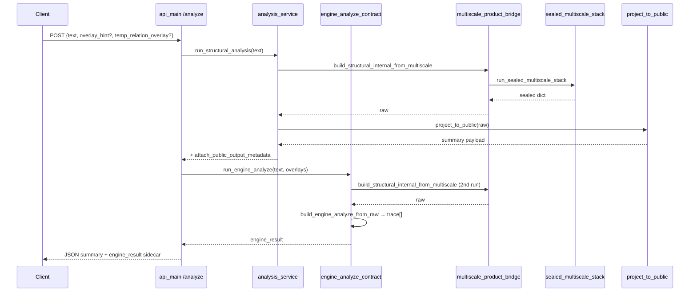

# Hesperia Description Object Investigation — Run 04 of 05

**Title:** Shipping path — `POST /analyze`, public projection, ENGINE-ANALYZE contract, `trace[]` iteration  
**Version:** Hesperia 0.6.3 (description object investigation)  
**Product SHA:** `e9eaa07`  
**Index:** [HESPERIA-DESCRIPTION-OBJECT-INVESTIGATION-0.6.3-INDEX.md](HESPERIA-DESCRIPTION-OBJECT-INVESTIGATION-0.6.3-INDEX.md) · **Prior:** [RUN-01](HESPERIA-DESCRIPTION-OBJECT-INVESTIGATION-0.6.3-RUN-01.md) … [RUN-03](HESPERIA-DESCRIPTION-OBJECT-INVESTIGATION-0.6.3-RUN-03.md)

---

## Abstract

Run 04 documents the **operator-facing HTTP surface** and the **ENGINE-ANALYZE sidecar** that 0.6.3 IRC Teacher consumes. A single `POST /analyze` performs **two sealed multiscale passes** on the same text (summary envelope + `engine_result`), builds **`trace[]`** from marker-concept samples or family-rank fallback, projects internal `raw` through **public vocabulary guards**, and returns a JSON response validated against forbidden internal keys. **`mode`** is accepted on the request body but the shipping handler at `e9eaa07` does **not** branch on it — overlay fields drive trace perturbation instead.

---

## 1. HTTP entry — `runtime/shipping/api_main.py`

### 1.1 Server bootstrap

| Block | Purpose |
|-------|---------|
| `_license_ok()` | Optional license gate at import |
| `create_app()` | FastAPI factory |
| `HESPERIA_REQUIRE_SYSTEM_SEAL=1` | Refuses bind if system seal fails |
| `_startup_fingerprint` | `check_hesperia_env`, schema SHA256, prints `mode: sealed_evaluator` |
| `uvicorn` `__main__` | `HESPERIA_API_HOST`, `HESPERIA_API_PORT` (default 8000; prod often 9005) |

**Capabilities:** `public_capability("analyze"|"compare"|"batch")` from `hesperia.system.capabilities`.

**Rate limit:** in-memory `_RATE` — `HESPERIA_RATE_LIMIT` requests/minute (default 60).

**Input cap:** `HESPERIA_MAX_INPUT_CHARS` (default 10000) on `AnalyzeBody.text`.

### 1.2 Request body — `AnalyzeBody`

```python
class AnalyzeBody(BaseModel):
    text: str = Field(..., min_length=1, max_length=_MAX_INPUT_CHARS)
    mode: str = Field(default="standard", pattern="^(reflection|standard)$")
    overlay_hint: dict[str, Any] | None = None
    temp_relation_overlay: list[dict[str, Any]] | None = None
```

| Field | Required | Used in handler @ `e9eaa07` |
|-------|----------|----------------------------|
| `text` | yes | yes — both analysis paths |
| `mode` | default `standard` | **no** — not passed to services (forward-compat / Java parity) |
| `overlay_hint` | no | yes — `run_engine_analyze` only |
| `temp_relation_overlay` | no | yes — `run_engine_analyze` only |

Brain contract reference: [ENGINE-ANALYZE-CONTRACT-REFERENCE.md](ENGINE-ANALYZE-CONTRACT-REFERENCE.md).

### 1.3 `POST /analyze` handler — dual pipeline

```python
@app.post("/analyze")
def analyze(analyze_body: AnalyzeBody = Body(...)):
    # gates: capability, rate limit
    assets = _assets_root()  # HESPERIA_ASSETS_ROOT or lexicon/curated
    summary_payload = run_structural_analysis(analyze_body.text, assets_root=assets, stages="full")
    engine_result = run_engine_analyze(
        analyze_body.text,
        assets_root=assets,
        overlay_hint=analyze_body.overlay_hint,
        temp_relation_overlay=analyze_body.temp_relation_overlay,
    )
    return _safe_response_with_engine(summary_payload, engine_result)
```

**Concomitant execution:** sequential, same thread — **two full** `build_structural_internal_from_multiscale` runs (one inside each service call). Not cached between summary and sidecar.

**Response shape:**

```json
{
  "system_version": "...",
  "build_id": "...",
  "schema_version": "v1",
  "calibration_profile": "...",
  "pipeline_version": "...",
  "execution_flow_version": "...",
  "orchestration_mode": "API_SYNC",
  "payload": { "...": "projected L1–L7, usf, diagnostics-safe keys" },
  "engine_result": { "contract_version": "v1.0", "trace": [...], ... }
}
```

`_safe_response_with_engine` runs `validate_against_public_schema` on the **summary** tree, then attaches **`engine_result` without re-walking** it for public schema (sidecar is ENGINE-ANALYZE contract, not public SUMMARY schema).

---

## 2. Service facade — `runtime/services/analysis_service.py`

### 2.1 `run_structural_analysis` block flow

| Step | Code | State |
|------|------|-------|
| 1 | Reject legacy `profile_*` args | ValueError if sphere profile requested |
| 2 | `stages != "full"` check | only canonical multiscale allowed |
| 3 | `build_structural_internal_from_multiscale(text, assets, …)` | internal `raw` dict (Run 03) |
| 4 | `project_to_public(raw, validate_schema=True)` | public-safe dict |
| 5 | Optional DLCR if `structural_dlcr_allowed()` | merges `lexical_resolution` into `payload` |
| 6 | `attach_public_output_metadata(..., orchestration_mode="SERVICE_SYNC")` | version envelope |

**Output parameters:** `payload` (projected layers), top-level version keys — consumed by API client and dossiers.

**Rejected paths:** `HESPERIA_SPHERE_PIPELINE_DEV=1` legacy runners are **not** invoked here; profile-based orchestration raises.

### 2.2 `run_structural_analysis_batch`

Same inner loop per text; `orchestration_mode="SERVICE_BATCH"`. `/batch-analyze` returns list via `_safe_response(results)` — **no** `engine_result` sidecar per row.

---

## 3. Internal assembly — `build_structural_internal_from_multiscale`

**File:** `hesperia/engine/multiscale_product_bridge.py` (Run 03 S0–S11).

**Preprocess:** `prepare_structural_analysis_text(text, policy_mode)` — NFKC, casefold, optional clinical role fold (`HESPERIA_CLINICAL_STRIP_ROLES`).

**Raw dict buckets** (pre-projection):

| Key | Content | Public fate |
|-----|---------|-------------|
| `L1` | attribution metrics + `CANONICAL_PIPELINE` | projected |
| `L2`–`L6`, `L8` | pipeline stamps | projected |
| `L7` | trust tag, tier, HSPR score | projected |
| `L9` | `BRAND_WORD_TRUST` | projected |
| `usf.raw_metrics` | `macro_domain_vector` (10 public areas), dominant | projected |
| `multiscale_signals` | hex-derived scalars, renamed keys in projection | partially stripped / renamed |
| `diagnostics` | interpretability, calibration, energy trace | sanitized — internal keys removed |

**L1 fallback:** if `ATTRIBUTED_TOKENS==0`, synthesize matches from `family_activation_vector` (`sealed_family_activation_to_L1`).

---

## 4. Public projection gate

### 4.1 Engine façade — `hesperia/engine/projection/public_projection.py`

```python
def project_to_public(internal_state, *, validate_schema=True):
    out = apply_public_projection(internal_state)  # core.projection
    if validate_schema:
        enforce_public_schema(out)  # runtime.shipping.schema_guard
    return out
```

**Rule:** product code must not call `core.projection` directly — auditable choke point.

### 4.2 Vocabulary remap — `core/projection/public_projection_layer.py`

**`apply_public_projection` → `sanitize_public_trace`:**

- Drops reserved areas (10–11) and families (240–287) from vectors.
- Remaps keys: e.g. `area_vector` → `macro_domain_vector`, `pipeline` → `execution_flow`.
- Strips `_is_internal_revealing_key` entries (hex, side_id, propagation_path, …).
- Filters trace list items referencing reserved topology.

**Public counts:** 10 operational areas, 240 families (12/288 internal with 2+48 reserved).

### 4.3 Schema guard — `runtime/shipping/schema_guard.py`

**`validate_public_schema_strict`:** walks entire JSON tree before serialization.

Forbidden key **substrings:** `sphere`, `hex`, `topology`, `bridge`, `side_id`, `area_id`, `family_id`, `layer_`, …

**Ambiguous standalone keys** blocked unless legacy allowlist (`governance`, `loopability`, …).

**Effect:** internal `multiscale_signals.microcell_activation_map` and similar **must not** appear in operator SUMMARY payload after projection — hex mass survives only in sidecar-adjacent diagnostics paths that pass sanitization rules.

---

## 5. ENGINE-ANALYZE sidecar — `runtime/services/engine_analyze_contract.py`

### 5.1 Entry — `run_engine_analyze`

```python
raw = build_structural_internal_from_multiscale(text, assets, document_id="engine_analyze")
return build_engine_analyze_from_raw(raw, overlay_hint=..., temp_relation_overlay=...)
```

Second full sealed stack run — **`raw` is not projected** before trace extraction (uses `multiscale_signals` + `diagnostics.interpretability_trace`).

### 5.2 Scalar mapping — sealed → contract

| ENGINE-ANALYZE field | Source in `raw` | Transform |
|----------------------|-----------------|-----------|
| `governance` | `multiscale_signals.hspr_index` | clamp [0,1] |
| `loopability` | `multiscale_signals.propagation_strength` | clamp |
| `tension_energy` | `multiscale_signals.contradiction_pressure` | clamp |
| `obstacle_score` | `1.0 - hspr_index` | clamp |
| `contradiction_flags` | — | `[]` (empty @ e9eaa07) |
| `weak_signals` | — | `[]` |
| `contract_version` | — | `"v1.0"` |
| `trace_content_hash` | SHA256 of trace JSON | determinism audit |

**Note:** `tension_energy` maps **contradiction_pressure**, not area-pair tension from modular Spine A (`compute_tension`).

### 5.3 Dominants — derived from trace

```python
dom_a, dom_f, dom_c = _dominants_from_trace(trace)
# top = max(trace, key=activation)
```

**Acceptance rule (HSPR-03):** `dominant_*` must match highest `activation` in `trace[]`.

---

## 6. `trace[]` iteration — step construction

### 6.1 Primary path — `_trace_from_marker_sample`

**Input rows:** `diagnostics.interpretability_trace.marker_concept_sample` (from sealed stack `concept_layer`, cap 64 at source).

**Per row iteration:**

```python
for row in sample:
    gfi = int(row.get("linked_family") or row.get("concept_index", 0))
    area_id, family_id = _area_and_family(gfi, AREA_IDS)  # area_i = gfi // 24
    base_act = family_activation[gfi] if in range else 0.5
    # overlay_hint family_biases: prior_boost, governance_modifier, contradiction_penalty
    activation = clamp(base_act + temp_boost + biases)
    confidence = clamp(activation * 0.95 + 0.05)
    steps.append({ area_id, family_id, concept_id, label, activation, confidence })
```

**Area id source:** `AREA_IDS` from `hesperia/engine/tfp_signal_calibration.py` (12 canonical strings from JSON calibration).

**Family id format:** `family_{gfi:03d}` (global index 0–287).

**Label:** token string or `concept_id` from marker trace row.

### 6.2 Fallback — `_trace_from_family_vector`

If marker sample yields **empty trace**:

```python
ranked = sorted(enumerate(family_activation), key=-value)[:8]
# synthetic concept_id: synthetic_family_{gfi:03d}
```

Top-8 nonzero families by activation — ensures non-empty trace for contract compliance.

### 6.3 Overlay perturbation (HSPR-19)

**`temp_relation_overlay`:** average `proposed_strength` → uniform `temp_boost` added to every trace step activation.

**`overlay_hint.family_biases`:** keys `"{area_id}:{family_id}"` → additive modifiers before clamp.

**Ping-pong test:** same text ± overlay → different `trace_content_hash` when overlay alters activations.

### 6.4 Trace step schema (each element)

| Field | Type | Bounds | Purpose |
|-------|------|--------|---------|
| `area_id` | string | canonical A* | macro region |
| `family_id` | string | `family_NNN` | meso index |
| `concept_id` | string | registry id or synthetic | concept anchor |
| `label` | string | public-safe token | operator display |
| `activation` | float | [0, 1] | strength |
| `confidence` | float | [0, 1] | derived from activation |

**Iteration index:** implicit order = marker trace order (token attribution sequence) or family rank order (fallback). **Not** hex cell index — trace is **concept/family visibility**, not 72k hex walk.

---

## 7. End-to-end flow diagram



---

## 8. Consumer paths

### 8.1 Generic API client

Reads `payload.L7.OUTPUT_TRUST_TAG`, `payload.usf.raw_metrics.macro_domain_vector`, version envelope.

### 8.2 0.6.3 IRC Teacher — `runtime/irc_teacher/analyze_adapter.py`

```python
data = json.loads(POST /analyze response)
engine_result = data.get("engine_result") if sidecar else data
# requires engine_result.trace
ksi_block = engine_result.get("ksi") or {}  # empty on product @ e9eaa07 unless extended
interior_pov = engine_result.get("interior_pov")
gtp_coherence = engine_result.get("gtp_coherence")
```

**Verified @ `e9eaa07`:** product `engine_result` contains ENGINE-ANALYZE fields only — **no `ksi`**, **`interior_pov`**, **`gtp_coherence`** unless added by tersagor hybrid_retriever post-process or future port. Envelope builder tolerates empty KSI.

### 8.3 Java live engine (HES-61-01)

Tersagor `docs/ENGINE-ANALYZE-CONTRACT.md` — parity target for `trace[]` and dominants; Python shipping path is reference implementation for HSPR-01/02.

---

## 9. Related endpoints (same file)

| Route | Service | `engine_result` |
|-------|---------|-----------------|
| `POST /compare` | two× `run_structural_analysis` | no |
| `POST /batch-analyze` | `run_structural_analysis_batch` | no |
| `GET /health` | static ok | no |
| `GET /version` | if `expose_version_endpoint()` | no |

---

## 10. Error and security boundaries

| Condition | Response |
|-----------|----------|
| ValueError / KeyError / TypeError in handler | `_neutral_500()` — `{"error":"internal_processing_error"}` |
| Rate limit | HTTP 429 |
| Capability disabled | HTTP 403 |
| Schema violation before emit | ValueError → 500 |
| Module paths in errors | forbidden substrings in guard |

**No** raw stack traces to client on shipping surface.

---

## 11. Env and assets (shipping-relevant)

| Variable | Effect |
|----------|--------|
| `HESPERIA_ASSETS_ROOT` | dict_a/b + lexicon root |
| `HESPERIA_API_HOST` / `PORT` | bind |
| `HESPERIA_MAX_INPUT_CHARS` | request validation |
| `HESPERIA_SHIPPING_ENV_STRICT` | startup env allowlist |
| `HESPERIA_SCHEMA_SHA256` | public schema integrity |
| `HESPERIA_CLINICAL_STRIP_ROLES` | text prep |
| `HESPERIA_CONCEPT_EVIDENCE_GUARD` | marker strictness → trace sample content |
| DLCR capability flags | optional `lexical_resolution` in payload |

---

## 12. Worked example — trace iteration (conceptual)

**Input:** one attributed token maps to `concept_index=42`, `linked_family=42`, token `"стыд"`.

**Family activation:** `F[42]=0.73` from sealed stack.

**Row processing:**

- `area_id = AREA_IDS[42 // 24]` → area index 1
- `family_id = "family_042"`
- `base_act = 0.73`
- No overlay → `activation = 0.73`, `confidence ≈ 0.744`

**Dominants:** if this step has max activation in trace → `dominant_family_id="family_042"`, etc.

**Sidecar scalars:** if `hspr_index=0.62`, `contradiction_pressure=1.24`, `propagation_strength=0.018`:

- `governance=0.62`, `loopability=0.018`, `tension_energy=1.0` (clamped), `obstacle_score=0.38`

---

## 13. File map (Run 04)

| File | Role |
|------|------|
| `runtime/shipping/api_main.py` | FastAPI routes, dual analyze |
| `runtime/services/analysis_service.py` | SUMMARY path |
| `runtime/services/engine_analyze_contract.py` | sidecar + trace[] |
| `hesperia/engine/multiscale_product_bridge.py` | raw assembly |
| `hesperia/engine/projection/public_projection.py` | projection gate |
| `core/projection/public_projection_layer.py` | vocabulary sanitize |
| `runtime/shipping/schema_guard.py` | forbidden key walk |
| `core/lexical/analysis_input.py` | text preprocess |
| `hesperia/system/version.py` | public metadata envelope |

---

## 14. Run 04 summary

| Topic | Result |
|-------|--------|
| `/analyze` | Two sequential sealed runs → projected summary + ENGINE-ANALYZE sidecar |
| `trace[]` | One step per marker sample row (or top-8 family fallback) |
| Overlays | Perturb activations; affect hash, not hex math directly |
| Public vs sidecar | Summary schema-scrubbed; sidecar carries trace for Teacher/KSI consumers |
| `mode` field | Accepted, not branched @ `e9eaa07` |
| 0.6.3 | `analyze_adapter` reads `engine_result.trace`; KSI blocks optional/absent on product |

---

## NEXT (Colombo)

1. [ ] **Run 05** — 0.6.3 IRC Teacher full RU trace, MySQL ledger, parameter tables, bibliography — owner: **Colombo**
2. [ ] Felix: wire KSI/geometry into `engine_result` on product if tersagor parity required — owner: **Felix** (Grace triage)
3. [ ] Gena: Java ENGINE-ANALYZE parity tests vs Python sidecar — owner: **Gena**

**Verified exists:** handler + contract @ `e9eaa07`; dual-call pattern in source  
**Still unverified:** prod prichindel `:9005` response sample with live RU statement (Run 05)

---

SIGNED: Research (Colombo) | Hesperia description object investigation Run 04 | 2026-06-14 | v0.6.3
