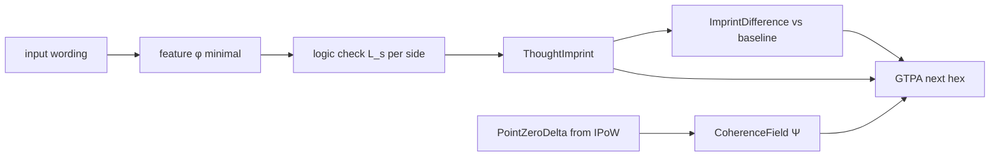

# Hesperia formalization — General thought propagation, hex orientation, and surface coherence

**Document ID:** `23_SPEC__General_Thought_Propagation_and_Hex_Orientation_v0_1`  
**Short name:** **GTP** (General Thought Propagation) / **GTPA** (algorithm)  
**Status:** FORMALIZATION (brain draft — **no implementation tasks**).  
**Authority:** Ethan (governance). **Plane:** Sphere logic expansion on `HexSphere` + **IPoW** coupling.  
**Depends on:** [HESPERIA-FORMALIZATION-GEODESIC-SPHERE-AND-INTERIOR-POINT-OF-WORLD-VIEW-v0_1.md](HESPERIA-FORMALIZATION-GEODESIC-SPHERE-AND-INTERIOR-POINT-OF-WORLD-VIEW-v0_1.md) (`22_SPEC__`, GCS, IPoW), [SPEC-GRACE-HESPERIA-INTERIOR-POINT-OF-WORLD-VIEW.md](SPEC-GRACE-HESPERIA-INTERIOR-POINT-OF-WORLD-VIEW.md).  
**Promotion target:** `docs/specs/23_SPEC__General_Thought_Propagation_and_Hex_Orientation_v0_1.md` on `igareosh/hesperia`.  
**Added:** 2026-05-24. **Triaged → active.md** 2026-05-24 (**GTP-01 … GTP-08**, P2 hesperia, OPEN).

---

## 0. Document control

| Field | Value |
|-------|--------|
| **Version** | `0.1.0` |
| **Principle** | **As above, so below** — interior **IPoW** in Ω deterministically constrains the next surface move on ∂Ω. |
| **Future product name** | **General thought propagation algorithm** (`gtp.v0_1` / `sphere.thought_propagation`) |

---

## 1. Scope

This specification extends Hesperia **hex logic** without changing **INV-HEX-PER-FAM-SEM** (250) or area/family counts:

1. **Hex orientation** — each **HexCell** may **rotate** in the surface plane (sixfold symmetry). Rotation changes which **logical** and **semantic** operator is “forward” for traversal.  
2. **Six sides × dual operators** — each **TruthUnit** side carries:
   - a **logical operator** (programming / set-theoretic), and  
   - a **semantic operator** (Romanian preset with English equivalent).  
3. **Calibration rotation** — during calibration (LLM-assisted or deterministic), a hex may rotate to align input wording with a **preprogrammed basic logical path** (existing traversal / loopability policy).  
4. **`PointZeroDelta` broadcast** — change in **IPoW** relative to **PointZero** is sent to **all** areas and families as one **coherence precursor** field.  
5. **Coherence aggregate Ψ** — single large calculable variable (vector + scalar summaries) used to **precalculate** the best **next hex** direction on the surface with **minimal semantic involvement** (logic + imprint + difference vs baseline families/areas).  
6. **Path discovery** — new surface paths from **input wording** → logic check → imprint → difference, tied to original area/family anchors, not free-form LLM semantics.

**Out of scope v0.1:** Production code, calibration JSON, LLM prompts, clinical claims.

---

## 2. Normative references

| Ref | Role |
|-----|------|
| `22_SPEC__` GCS + IPoW | Volume Ω, surface ∂Ω, PointZero, GCS_NU85 |
| `40_POLICY__Loopability_and_traversal` | Preprogrammed path templates, borders, loops |
| `20_GEOMETRY__formalized_structure` | HexCell, TruthUnit, six sides |
| `propagation_trace` (TFP) | **Distinct** — graph field propagation; GTP is path/orientation logic |
| `context_rag` `coherence_hints` | Extension point for Ψ |

---

## 3. Definitions

| Term | Definition |
|------|------------|
| **HexOrientation** | Rotation of a HexCell in the tangent plane of ∂Ω; **`hex_rotation`** ∈ {0,…,5} (side index offset) or **`hex_rotation_deg`** ∈ [0,360). |
| **LogicalOperator** | Set-theoretic / programming-style test on input features (includes, excludes, …). |
| **SemanticOperator** | Surface-language relation label (RO preset; EN equivalent). |
| **SideSlot** | One of **6** sides of a hex; **`side_id`** 0..5. |
| **PointZeroDelta** | **`δ_powv`** = change in IPoW position vs PointZero (or step-to-step); broadcast to all area/family anchors. |
| **CoherenceField Ψ** | Aggregated calculable object from **`δ_powv`** + light area/family weights — **one coherence variable** for next-step steering. |
| **ThoughtImprint** | Surface record of which sides/operators fired on input wording (minimal semantic). |
| **ImprintDifference** | Δ between imprint and baseline / prior step — drives path discovery. |
| **GTPA** | General thought propagation algorithm — deterministic next-hex choice given Ψ, orientation, path template. |

---

## 4. Principle — as above, so below

```text
Ω  (volume)                    ∂Ω  (surface)
─────────────────────────────────────────────
IPoW.powv_position  ──Π──►   HexOrientation + exit SideSlot + next HexCell
PointZeroDelta δ    ──B──►   CoherenceField Ψ  ──►  argmax next hex on GCS
```

**Normative:** For frozen **`anchor_map_v1`**, **`gcs_id`**, and path template **P**:

```text
(next_hex, next_side, hex_rotation') = GTPA(
    powv_position_t,
    δ_powv_t,
    current_hex,
    hex_rotation,
    input_wording_features φ,
    path_template P
)
```

**Π** (above-to-below map): projects interior vector to local surface frame (area ring angle, family patch, hex coordinates). **B** (broadcast): distributes **`δ_powv`** to all **12 + 288** anchors (areas + families). **No contradiction** with Apple surface path: Apple walks ∂Ω; GTPA chooses **legal** next step; IPoW supplies **Ω** bias.

---

## 5. Hex orientation (rotation)

### 5.1 State

Each **HexCell** at `(area_id, global_id, hex_index)` carries:

| Field | Type | Meaning |
|-------|------|---------|
| `hex_rotation` | int mod 6 | Permutation offset of side labels (default **0**) |
| `hex_rotation_deg` | float | Optional display: `hex_rotation × 60°` |

**Active side** after rotation:

```text
side_active(k) = (k + hex_rotation) mod 6    for k ∈ {0,…,5}
```

### 5.2 Calibration rotation (thought mimic)

During **calibration** (LLM may propose; engine **must** verify deterministically):

```text
hex_rotation' = argmax_{r ∈ {0,…,5}}  Σ_{k=0}^{5}  match( φ(input), LogicalOperator[side_active(k;r)], SemanticOperator[side_active(k;r)] ) )
```

- **LLM role:** propose candidate `r` or wording→operator alignments.  
- **Engine role:** score, select, log provenance; **same input + same pins → same `hex_rotation'`**.

Rotation **mimics thought orientation**: input wording approaches the hex from a different “face” without moving the hex’s semantic `(area, family)` anchor.

---

## 6. Six sides — logical operators (programming logic)

Each **SideSlot** `s ∈ {0,…,5}` has exactly one **LogicalOperator** `L_s` from the closed set:

| `side_id` | `L_s` (id) | Programming reading | Typical test on input feature set `F` and hex/local set `H` |
|-----------|------------|---------------------|---------------------------------------------------------------|
| 0 | `INCLUDES` | includes / contains | `F ∩ H ≠ ∅` (non-empty intersection) |
| 1 | `NOT_INCLUDES` | does not include | `F ∩ H = ∅` |
| 2 | `SUBSUMES` | covers / implies all | `H ⊆ closure(F)` (configurable closure) |
| 3 | `OVERLAPS` | partial overlap | `F ∩ H ≠ ∅` and `F \ H ≠ ∅` and `H \ F ≠ ∅` |
| 4 | `DISJOINT` | disjoint from | `F ∩ H = ∅` and required separation |
| 5 | `EQUIVALENT` | same extension (under policy) | `symmetric_match(F, H)` |

**Invariant:** **INV-HEX-SIDES-6** — exactly **6** sides; **INV-LOGICAL-OPS-6** — one `L_s` per side in the preset table above (v0.1).

Implementations **MAY** map `L_s` to existing traversal / guard predicates already in the product; GTP **formalizes** the binding to **SideSlot**, not new ad-hoc rules per run.

---

## 7. Six sides — semantic operators (Romanian preset, English equivalent)

Romanian surface labels (operator-endorsed preset) and **English equivalents** for docs/code:

| `side_id` | RO (semantic) | EN (equivalent) | Role on surface |
|-----------|---------------|-----------------|-----------------|
| 0 | **cu** | **with** | comitative / accompaniment |
| 1 | **din** | **from** | source / origin |
| 2 | **la** | **at** / **to** | location / goal |
| 3 | **spre** | **toward** | direction |
| 4 | **după** | **after** | temporal / sequential follow |
| 5 | **pentru** | **for** | purpose / beneficiary |

### 7.1 Reserved — **fără** (without)

| Term | Status |
|------|--------|
| **fără** | **WITHOUT** — exists in Romanian operator vocabulary; **stateless / undefined** in v0.1 (not bound to a `side_id`). |

**Normative:**

- **`fără`** **SHALL** appear in the operator registry as **`SemanticOperator.FARA`** with `stateless: true`, `side_id: null`.  
- Future ADR may assign **`fără`** to a side, a guard, or a **volume-only** (Ω) modifier — not on ∂Ω without explicit approval.  
- Matching **`fără`** in input **does not** rotate the hex in v0.1; it **may** affect **`δ_powv`** magnitude (inward / exclusion bias) when wired.

**Invariant:** **INV-SEM-OPS-6** — six **assigned** RO/EN pairs on sides; **INV-FARA-STATELESS** — `fără` registered but unassigned.

---

## 8. Dual operator on one side

For side `s` after rotation:

```text
SideSpec(s) = ( L_{(s + hex_rotation) mod 6},  Σ_{(s + hex_rotation) mod 6} )
```

**Match score** for input wording features **φ**:

```text
m_s = w_L · match_logical(φ, L) + w_Σ · match_semantic(φ, Σ)     with w_L + w_Σ = 1
```

Default **`w_L = 0.7`**, **`w_Σ = 0.3`** (calibration file may override). GTPA prioritizes **logic**; semantic RO/EN is tie-break and audit label.

---

## 9. PointZeroDelta and coherence field Ψ

### 9.1 PointZeroDelta

At step `t`, with IPoW position **`r_t`** (from `22_SPEC__`):

```text
δ_powv_t = r_t − r_zero        where r_zero = (0,0,0) at PointZero
```

Step-to-step variant (optional):

```text
δ_powv_step_t = r_t − r_{t−1}
```

**Broadcast** to every area `i` and family `j` with unit anchor direction **`s_{i,j}`**:

```text
δ_{i,j} = dot(δ_powv_t, s_{i,j})     scalar signed projection
```

Also broadcast to **12** area ring anchors and **288** family anchors (families use patch center directions from `anchor_map_v1`).

### 9.2 Coherence field Ψ — “one big variable”

**Ψ** is the **single coherence object** precalculating surface propagation. v0.1 decomposition:

**Vector part** (dimension **300** = 12 areas + 288 families):

```text
Ψ_k = δ_k     for k in areas ∪ families
```

**Scalar summaries** (for logs / `coherence_hints`):

```text
Ψ_abs   = ||δ_powv_t||
Ψ_ent   = −Σ_k  p_k log p_k     where p_k = |δ_k| / Σ|δ_k|   (distribution shape)
Ψ_align = max_k δ_k − min_k δ_k
```

**Coherence scalar (one number for driver):**

```text
C_t = aggregate(Ψ) = α·Ψ_abs + β·Ψ_align − γ·variance(δ_family)
```

Coefficients **`α, β, γ`** live in calibration (`gtp_coherence_v0_1.json` — future).

**Use:** **`C_t`** and full **`Ψ`** steer **next hex** jointly with path template **P** — **not** full LLM semantic re-classification.

---

## 10. GTPA — next hex selection (deterministic core)

### 10.1 Neighborhood

Let **`h`** = current HexCell on GCS. **`N(h)`** = legal neighbors from **loopability / traversal** policy (area ring steps, family patch steps, hex index steps — frozen graph).

### 10.2 Score

For each candidate **`h' ∈ N(h)`**:

```text
Score(h') = η · PathPrior(h, h', P)
          + κ · CoherenceAlign(h', Ψ)
          + λ · Σ_{s=0}^{5} m_s(h', s)
          − μ · SemanticPenalty(h')        # small; default μ → 0 for “almost no semantic”
```

| Term | Meaning |
|------|---------|
| `PathPrior` | Existing basic logical path — borders, direction, loopability from `40_POLICY` |
| `CoherenceAlign` | `dot(direction(h→h'), normalize(Ψ_vector))` or lookup table from anchor map |
| `Σ m_s` | Side match under trial rotation at `h'` |
| `SemanticPenalty` | Optional dampener on heavy concept/lexical jumps — default **off** in discovery mode |

**Choice:**

```text
h* = argmax_{h' ∈ N(h)} Score(h')
exit_side* = argmax_{s} m_s(h*, s)
hex_rotation* = argmax_{r ∈ {0,…,5}}  (rotation score at h*)
```

Ties broken by: lower `global_id`, then lower `hex_index`, then lower `side_id` (**deterministic**).

### 10.3 Path discovery pipeline (wording → surface)



| Stage | Output | Semantic load |
|-------|--------|----------------|
| Logic check | which `L_s` fire | **low** |
| Imprint | `(hex, side, operators)` | **low** |
| Difference | Δ vs area/family baseline | **anchor-only** |
| GTPA step | next `(hex', side', rotation')` | **low** |

**Baseline** = original **Area** / **Family** attachment of the session slice, not book corpus retrieval.

---

## 11. Math summary (implementation card)

| # | Formula | Symbol |
|---|---------|--------|
| 1 | Active side | `(k + hex_rotation) mod 6` |
| 2 | Side match | `m_s = w_L·match_logical + w_Σ·match_semantic` |
| 3 | PointZeroDelta | `δ_powv = r_t − r_zero` |
| 4 | Broadcast | `δ_k = dot(δ_powv, s_k)` for each area/family anchor `k` |
| 5 | Coherence scalar | `C_t = α·‖δ_powv‖ + β·(max δ_k − min δ_k) − γ·Var(δ_family)` |
| 6 | Next hex | `h* = argmax_{h'∈N(h)} Score(h'; Ψ, P, {m_s})` |
| 7 | Above-below | `(h*, side*, rot*) = GTPA(r_t, δ_powv, h, rot, φ, P)` |

---

## 12. Relation to existing Hesperia planes

| Existing | GTP relation |
|----------|----------------|
| **TFP `areas` / `families` vectors** | Baseline anchor weights; **not** replaced by Ψ |
| **`propagation_trace`** | Separate graph smoothing; **must not** duplicate GTPA |
| **Apple path** | Records actual walk; GTPA **proposes** legal next step |
| **Guards / shadow** | May veto `h*` if `Score` violates guard policy |
| **IPoW** | Supplies **`r_t`**, **`δ_powv`**; GTP supplies **surface** move |

---

## 13. Proposed registry (future bundle)

```json
{
  "gtp_v0_1": {
    "hex_rotation": 0,
    "side_specs": [
      { "side_id": 0, "logical": "INCLUDES", "semantic_ro": "cu", "semantic_en": "with" },
      { "side_id": 1, "logical": "NOT_INCLUDES", "semantic_ro": "din", "semantic_en": "from" },
      { "side_id": 2, "logical": "SUBSUMES", "semantic_ro": "la", "semantic_en": "at" },
      { "side_id": 3, "logical": "OVERLAPS", "semantic_ro": "spre", "semantic_en": "toward" },
      { "side_id": 4, "logical": "DISJOINT", "semantic_ro": "dupa", "semantic_en": "after" },
      { "side_id": 5, "logical": "EQUIVALENT", "semantic_ro": "pentru", "semantic_en": "for" }
    ],
    "semantic_reserved": [
      { "id": "FARA", "semantic_ro": "fara", "semantic_en": "without", "stateless": true, "side_id": null }
    ],
    "point_zero_delta": { "x": 0.0, "y": 0.0, "z": 0.0 },
    "coherence": {
      "psi_scalar": 0.0,
      "psi_abs": 0.0,
      "psi_align": 0.0,
      "vector_dim": 300
    },
    "thought_imprint": [],
    "imprint_difference": {}
  }
}
```

---

## 14. ADR gates

| Change | Requires |
|--------|----------|
| Assign **`fără`** to a side | Operator ADR |
| Change **INV-LOGICAL-OPS-6** set | ADR + migration |
| Merge Ψ with TFP softmax areas | ADR — keep planes separate in v0.1 |
| LLM-only next hex (no GTPA argmax) | Forbidden in v0.1 |

---

## 15. Traceability

| Operator / brain | Hesperia formal |
|------------------|-----------------|
| Hex rotates | `HexOrientation` / `hex_rotation` |
| 6 programming operators | `LogicalOperator` `L_0..L_5` |
| cu, din, la, … | `SemanticOperator` `Σ_0..Σ_5` |
| fără | `FARA` stateless reserved |
| Point zero delta to all families/areas | `δ_powv`, broadcast `δ_k`, **Ψ** |
| Precalculate next hex | **GTPA** `Score`, `h*` |
| As above so below | **Π**, **GTPA** map Ω → ∂Ω |
| Future general thought propagation | **GTPA** / `gtp.v0_1` |

---

## 16. Phased backlog (triaged → active.md 2026-05-24)

| ID | Summary | Owner | Depends |
|----|---------|-------|---------|
| **GTP-01** | Freeze hex side operator tables (logical + RO/EN; FARA reserved) | Gena | — |
| **GTP-02** | `gtp_v0_1` schema + fixture | Felix | GTP-01 |
| **GTP-03** | `hex_rotation` + side match `m_s` | Gena | GTP-01 |
| **GTP-04** | PointZeroDelta broadcast + coherence Ψ | Gena | IPoV-03, GTP-01 |
| **GTP-05** | GTPA next-hex `Score` / argmax | Gena | GTP-03, GTP-04 |
| **GTP-06** | ThoughtImprint + ImprintDifference | Gena | GTP-03 |
| **GTP-07** | Bundle / `coherence_hints` wire | Felix | GTP-02, GTP-05 |
| **GTP-08** | Gold tests deterministic GTPA | Felix | GTP-05 |

## 17. Promotion checklist (dev repo)

1. Copy to `docs/specs/23_SPEC__General_Thought_Propagation_and_Hex_Orientation_v0_1.md`.  
2. Cross-link `22_SPEC__`, `20_GEOMETRY`, `40_POLICY`.  
3. Add operator table to `VARIABLES.md` §GTP (future).  
4. Implement when **GTP-*** rows marked DONE on active.md.

---

**SIGNED: Ethan (governance) | GTP hex orientation + coherence formalization v0.1 | 2026-05-24 | brain draft — no tasks**
