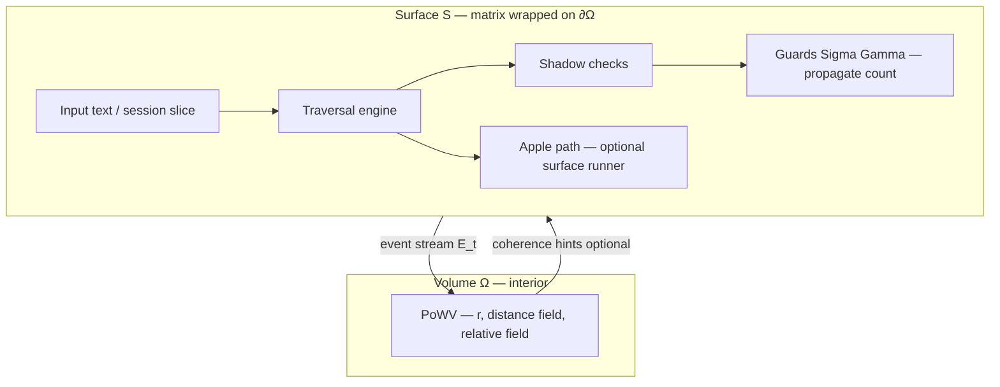

# Hesperia — Interior Point of World View (PoWV)

**Status:** CONCEPT / SPEC (pre-implementation). **Triage:** Grace (Hesperia dev). **Audience:** Gena, Felix, Ethan governance, Cursor agents with `fpf_mode` + matrix/books context. **Added:** 2026-05-24. **Geodesic sphere (operator canonical):** §1.2 — **72,240** hexes + **12** pentagons, mapped on **12×24** semantic structure. **Hesperia terms (formalization, no tasks):** [HESPERIA-FORMALIZATION-GEODESIC-SPHERE-AND-INTERIOR-POINT-OF-WORLD-VIEW-v0_1.md](HESPERIA-FORMALIZATION-GEODESIC-SPHERE-AND-INTERIOR-POINT-OF-WORLD-VIEW-v0_1.md) (`22_SPEC__…`, `GCS_NU85`, `InteriorPointOfWorldView`, invariants `INV-*`). **GTP (future):** [HESPERIA-FORMALIZATION-GENERAL-THOUGHT-PROPAGATION-v0_1.md](HESPERIA-FORMALIZATION-GENERAL-THOUGHT-PROPAGATION-v0_1.md) (`23_SPEC__`, hex rotation, side operators, **GTPA**, Ψ coherence).

**Operator intent (igareosh):** A **variable point of view** exists **inside** the closed spheroid (body ellipsoid). The **12×24 areas/families matrix** stays **on the surface**, as today. The interior point has its **own coordinate system** in the volume and **measurable distances** (absolute or **relative**) to every **area** and **concept** on the wrapped surface. While **input travels on the surface** (traversal, **shadow** checks, **guards** that propagate and count on the surface), this **point of world view** **moves inside** the sphere and **updates its coordinates** — or can be **set / integrated** directly and remain **calculable**.

---

## 1. Placement in the existing Hesperia spheroid

Hesperia already admits a **closed, loopable semantic spheroid** (compressed world view + geometry specs):

| Layer | What exists today | Role |
|-------|-------------------|------|
| **Surface geometry** | 12 areas (ring), 24 families/area, 250 hexes/family, 6 sides/hex (truth = statement) | Fixed topology; [BOOKS-LAYER-AND-MATRIX-COMPRESSED-WORLD-VIEW.md](../../governance/BOOKS-LAYER-AND-MATRIX-COMPRESSED-WORLD-VIEW.md) |
| **Matrix on surface** | `hesperia_families` / CSV coordinates `(area_id, global_id)`; `matrix_run` → `road_coordinates`, `border_passings` | Calculable path on the **surface**; [CONTEXT-RAG-PACKET-SCHEMA.md](../../governance/CONTEXT-RAG-PACKET-SCHEMA.md) |
| **Body ellipsoid** | “Matrix looped as traversable **body ellipsoid sphere**” | Surface embedding of the matrix; [TASK-GENA-APPLE-HESPERIDES-PATH-SCRIPTS.md](../../governance/TASK-GENA-APPLE-HESPERIDES-PATH-SCRIPTS.md) |
| **Surface agent — Apple** | Virtual runner: **self-describing point + path** on hex sides / statements | **On-surface** trajectory; imprint + involvements scripts |
| **Traversal + guards** | Traversal engines, **Sigma/Gamma** guards, obstacle/guard policy (tutorial + product) | Events and counts on **surface** traversal |
| **Shadow (runtime)** | `HESPERIA_K_SHADOW_PERTURB` and related core_math flags | Perturbation / shadow plane on field math — **not** yet a volumetric PoWV |
| **Interior-ish propagation (TFP)** | `propagation_trace`, `families_propagated`, `areas_propagated` when sphere embedding succeeds | Graph/field propagation from activations — **adjacent** but not defined as a single **PoWV** state |

**Gap this spec fills:** A **named, persistent, calculable interior state** — the **Point of World View (PoWV)** — with explicit **volume coordinates** and a **distance field** to all surface anchors (areas, families, concepts), **coupled** to surface traversal/guard/shadow events.

### 1.1 Semantic layer — Hesperia invariant (unchanged storage)

Content and matrix IDs stay on the **semantic** product (no ADR → no renumber):

| Level | Count | Formula |
|-------|------:|---------|
| **Areas** (ring) | 12 | invariant |
| **Families** per area | 24 | invariant |
| **Families** total | **288** | 12 × 24 |
| **Hexes** per family (baseline) | **250** | invariant per family row |
| **Hexes** total (semantic) | **72,000** | 12 × 24 × 250 |
| **Sides** (truth units) per hex | 6 | one statement slot per side |
| **Sides** total (semantic) | **432,000** | 72,000 × 6 |

**One-line (semantic):** `12 × 24 × 250 × 6 = 72,000 hexes, 432,000 truth sides`.

The **area ring** closes in 12 steps (CW/CCW); family and hex coordinates support **loopable traversal** in the Hesperia sense. Ref: [BOOKS-LAYER-AND-MATRIX-COMPRESSED-WORLD-VIEW.md](../../governance/BOOKS-LAYER-AND-MATRIX-COMPRESSED-WORLD-VIEW.md); `matrix_run` geometry (`TOTAL_HEXES`, `TOTAL_SIDES`).

### 1.2 Perfect geodesic sphere — **72,240 hexagons** (operator canonical for PoWV)

**Canonical for PoWV embedding (2026-05-24):** The **perfect closed sphere** used for distance math, anchor placement, and “perfect sphere” language in this spec is a **soccer-ball-class** polyhedron:

- **72,240** regular **hexagonal** faces on the surface dual mesh  
- **12** **pentagonal** faces (required — a closed sphere cannot be built from hexagons alone)  
- Mapped **onto** the existing **12 × 24** area/family structure without changing area or family **counts**

**Geodesic construction:**

| Parameter | Value |
|-----------|--------|
| **Frequency ν** | **85** |
| **Hex count formula** | `10ν² − 10` |
| **Hex count** | `10 × 85² − 10` = **72,240** |
| **Pentagon count** | **12** (fixed for spherical fullerene / soccer topology) |
| **Total faces** | **72,252** = 72,240 + 12 |
| **Δ vs semantic hex** | **+240** |

**Rejected alternate (documented only):** `20ν²` with **ν = 60** → **72,000** hex exactly (no +240). Operator chose **ν = 85** → **72,240** for a finer geodesic mesh while staying aligned with Hesperia inventory.

**Geometry truth (one line):** “Perfect sphere made of hexagons” in product language means **72,240 hex + 12 pent** on ∂Ω, embedded in volume Ω; PoWV at **point zero** sits at the **center** of that ball (§2.2).

---

#### 1.2.1 All outcomes — master table

| Outcome | Semantic (12×24×250) | Geodesic sphere (ν=85) | Δ |
|---------|--------------------:|-------------------------:|--:|
| **Areas** | 12 | 12 | 0 |
| **Families / area** | 24 | 24 | 0 |
| **Families total** | 288 | 288 | 0 |
| **Hexes** | 72,000 | **72,240** | **+240** |
| **Pentagons** | — (not in semantic grid) | **12** | +12 face type |
| **Total faces** | 72,000 (hex only in product) | **72,252** | — |
| **Sides (×6 per hex)** | 432,000 | **433,440** | **+1,440** |
| **Scale factor** | 1.0 | **1.0033333333** | +0.333…% |
| **Hexes / family (mean)** | 250.0 | **250.8333333333** | +0.833… |
| **Hexes / area (mean)** | 6,000 | **6,020** | +20 |
| **Extra hexes / area** | 0 | **20** | +20 |
| **Extra hexes / pentagon zone** | — | **20** | 240÷12 |

**Integer spacing on 12×24 (exact):**

| Outcome | Value |
|---------|------:|
| Families with **251** geodesic hex slots | **240** |
| Families with **250** semantic hex slots | **48** |
| Per area: **20×251 + 4×250** | **6,020** hex |
| Check | `240×251 + 48×250` = **72,240** |

**Default family selection for 250-slot families (48 total):** **4 per area** — symmetric on sphere; candidate rule `family_index_in_area % 6 == 0` or the 4 family sites nearest the **pentagon** pole for that area’s geodesic wedge (**IPoV-01** freezes the rule).

**Decimal spacing (math / interpolation):**

| Symbol | Value | Use |
|--------|------:|-----|
| **σ** | **1.0033333333** | `72240/72000` — uniform scale on spacing |
| **h̄** | **250.8333333333** | `72240/288` — mean hex density per family |
| **ȧ** | **6020** | `72240/12` — mean hex per area |
| **δ** | **0.8333333333** | `h̄ − 250` — fractional hex per family |
| **ε_area** | **20** | `240/12` — hex bump budget per area |

**Point zero (PoWV) on this sphere:**

| Outcome | At **r** = (0,0,0) |
|---------|---------------------|
| Chord distance to any anchor on ∂Ω (unit sphere) | **1.0** (all equal) |
| Relative distance \(\hat{d}_a\) | **1/N** uniform per tier |
| Barycentric areas | **1/12** each |
| Bias | **None** until surface events move PoWV |

**PoWV / storage policy:**

| Rule | |
|------|---|
| **Semantic store** | Stays **12×24×250**; matrix IDs unchanged |
| **Geodesic layer** | **72,240** hex anchors + **12** pentagon sites for ∂Ω math |
| **+240 hex** | Embedding-only (“251st” sub-cell or `geodesic_hex_index`) until ADR |
| **+1,440 sides** | Geodesic truth slots **433,440** when sides follow geodesic hex count |
| **Do not** | Silently equate 72,240 semantic product rows without migration |

---

#### 1.2.2 Mapping geodesic hex → 12×24×250

```text
For each area_id in 0..11:
  For each family_index in 0..23:
    if family is one of 4 "250-only" slots in this area (see §1.2.1):
      geodesic_hex_count = 250
      spacing_factor = 250 / 250.833333...  ≈ 0.996688
    else:
      geodesic_hex_count = 251
      spacing_factor = 251 / 250.833333...  ≈ 1.000663
    semantic_hex_index runs 0..249 always
    optional geodesic_extra_index = 250 when geodesic_hex_count = 251
```

**Area ring:** still **12** steps; **6020** geodesic hex per area vs **6000** semantic — use **σ** or per-family counts when converting arc length / density on ∂Ω.

**Pentagon poles (12):** each anchors **20** of the **+240** extra hex (conceptual wedge); the **4** families per area kept at **250** should align with pentagon-adjacent slots when possible.

---

#### 1.2.3 Comparison to classic soccer ball

| Object | Hexagons | Pentagons | Total faces |
|--------|----------|-----------|-------------|
| **FIFA-style ball** (truncated icosahedron) | **20** | **12** | 32 |
| **Hesperia geodesic (ν=85)** | **72,240** | **12** | **72,252** |
| **Hesperia semantic** | **72,000** (product) | — | 72,000 |

Same **topology class** (hex + exactly 12 pent); Hesperia is a **high-frequency** instance scaled to semantic inventory.

---

#### 1.2.4 PoWV implications

- **∂Ω** carries **72,240** hex anchor directions + **12** pentagon anchor directions for distance fields.  
- **Ω** interior: PoWV **r** unchanged; default **point zero** at center.  
- **Apple** remains on-surface path over semantic/geodesic coordinates; does not replace PoWV.  
- **IPoV-01** delivers: `anchor_map_v1` (semantic + geodesic), pentagon poles, 240/48 family split rule, **ν=85** metadata.

---

## 2. Concept definition

### 2.1 Point of World View (PoWV)

**PoWV** = one logical observer position inside the **unit spheroid** (implementation: unit ball or ellipsoid aligned with the body ellipsoid). It is **not** the Apple surface runner; it is the **interior stance** from which “how far / how near” to each semantic region is read.

Properties:

1. **Inside volume** — always \( \|\mathbf{r}\| \le 1 \) (or inside declared ellipsoid semi-axes).
2. **Coupled to surface** — surface anchors (area centroids, family sites, concept sites) lie on **∂Ω** (the wrapped matrix surface).
3. **Distance-bearing** — for each anchor \(a\): scalar \(d_a\) and optional **relative** \(\hat{d}_a = d_a / \sum_b d_b\) or \(d_a / d_{\max}\).
4. **Dynamic** — updates when (a) surface input moves (traversal step, guard event, shadow perturbation summary), or (b) direct assignment / integration step is applied.
5. **Calculable** — pure function of prior PoWV, surface event batch, and calibration knobs; reproducible given frozen topology + version pins.

### 2.2 Point zero — default when PoWV first appears

**Point zero** = the **default birth state** of PoWV whenever it is **created** (new session, new iteration, first attach to a run, or explicit reset).

| Field | Default |
|-------|---------|
| \(\mathbf{r}\) | **\((0, 0, 0)\)** — exact **center of the ball** (middle of Ω) |
| Semantic reading | **Perfect-sphere stance** on the **72,240-hex + 12-pent** geodesic ∂Ω (§1.2): equidistant to every **area**, **family**, **hex**, and **pentagon** anchor when embedded symmetrically on the unit sphere |
| `provenance.update_mode` | `point_zero` |
| Motion | **No drift** until the first surface event \(E_t\) or a **direct_set** |

**Meaning:** Before input pulls the viewpoint off-center, the observer stands at the **neutral center** — not biased toward any area/family/hex. On a **unit ball** with all anchor directions \(\mathbf{s}_a\) on \(\|\mathbf{s}_a\|=1\), chord distance from the origin is **the same for every anchor**:

\[
d_a = \|\mathbf{0} - \mathbf{s}_a\| = 1 \quad \forall a
\]

So **absolute** distances tie; **relative** distances \(\hat{d}_a\) are **uniform** (e.g. \(1/N\) over \(N\) anchors at the same tier). **Barycentric** area weights default to **uniform** \(1/12\) each. That is the **perfect sphere concept** at the middle of the ball — not a surface position, not Apple’s path start unless explicitly configured otherwise.

**Implementation note (IPoV-01):** Real CSV/geometry may use **slightly non-uniform** \(\mathbf{s}_a\); at \(\mathbf{r}=\mathbf{0}\) report equal \(d_a\) within float tolerance, or document the small spread from embedding. Do **not** skip point zero when anchors are irregular — still default \(\mathbf{r}=\mathbf{0}\), then show measured distances.

### 2.3 Surface vs interior (two agents, one spheroid)



- **Surface** owns **where** input walked (`road_coordinates`, border passings, guard/safeguard counts).
- **Interior** owns **from where** the session is “seen” relative to all areas/families/concepts.

---

## 3. Coordinate systems

### 3.1 Primary — volumetric \(\mathbf{r}\)

| Symbol | Meaning | Domain |
|--------|---------|--------|
| \(\mathbf{r} = (x, y, z)\) | PoWV position in body frame | Unit ball \(\|\mathbf{r}\| \le 1\) or ellipsoid \(\sum (r_i/a_i)^2 \le 1\) |
| \(t\) | Discrete time / step index | Iteration, traversal step, or session segment |

**Convention:** Origin = semantic **center** = **point zero** (§2.2); **surface** at \(\|\mathbf{r}\| = 1\) (or ellipsoid boundary). Areas sit on a **ring** embedded in the surface (existing area_id 0..11 CW/CCW). Any new PoWV **without** a prior state **must** initialize at \(\mathbf{r}=\mathbf{0}\) unless `provenance.update_mode` is an explicit non-default seed.

### 3.2 Surface anchors — fixed catalog (from topology)

For each anchor type, precompute **unit direction** \(\mathbf{s}_a\) from center to surface site (from `hex_sphere_areas_families_ideal_proportions.csv` + geometry spec):

| Anchor type | Count (invariant) | Surface site |
|-------------|-------------------|--------------|
| **Area** \(A_i\) | 12 | Ring node \(i\) |
| **Family** \(F_{i,j}\) | 288 | Sub-site on patch for area \(i\), family \(j\) |
| **Concept** \(C_k\) | dynamic per dict | Nearest family site or explicit concept pole when wired |
| **Hex** \(H_{i,j,k}\) | **72,240** (geodesic) / **72,000** (semantic IDs) | Geodesic: 250 or 251 per family per §1.2.2; semantic index 0..249 always |
| **Pentagon** \(P_p\) | **12** | Soccer-ball poles on ∂Ω; 20 extra hex per wedge (§1.2.1) |

At **point zero**, all **72,240** hex anchors and **12** pentagon anchors share chord distance **1.0** to \(\mathbf{r}=\mathbf{0}\) under symmetric unit-sphere embedding (§2.2).

### 3.3 Distance field (absolute and relative)

For PoWV at \(\mathbf{r}\):

**Absolute distance (Euclidean chord through volume):**

\[
d_a = \|\mathbf{r} - \mathbf{s}_a\|
\]

Optional **geodesic-style** distance on the sphere (great-circle from projection of \(\mathbf{r}\) to \(\mathbf{s}_a\)) — configuration flag; default **chord** for calculability.

**Relative distance** (operator-requested “some shorter some longer”):

\[
\hat{d}_a = \frac{d_a}{\sum_{b \in \mathcal{A}} d_b + \epsilon}
\quad\text{or}\quad
\hat{d}_a = \frac{d_a}{\max_b d_b + \epsilon}
\]

Store both **vectors** keyed by `area_id`, `global_id`, `concept_id` where applicable.

### 3.4 Optional — barycentric on ring (12 areas only)

For fast area-only views: project \(\mathbf{r}\) to the equatorial ring plane; express weights \(w_i \ge 0\), \(\sum w_i = 1\) over 12 areas. Use when full 288-family field is too heavy for a hot path.

---

## 4. Coupling: surface events → PoWV motion

### 4.1 Event stream \(E_t\)

Each surface step emits a record (conceptual shape):

| Field | Source |
|-------|--------|
| `step`, `area_id`, `global_id` | `road_coordinates` / traversal |
| `border_passings` | area/family crossings |
| `guard_events[]` | Sigma/Gamma / safeguard counters |
| `shadow_delta` | shadow perturb summary when `HESPERIA_K_SHADOW_PERTURB` (or successor) fires |
| `activation_slice` | optional areas/families/concepts weights for this step |

### 4.2 Update law (default — calculable draft)

**Pull toward visited surface sites** (input drags interior stance):

\[
\mathbf{r}_{t+1} = \mathrm{normalize}\Big( (1-\lambda)\,\mathbf{r}_t + \lambda \sum_{e \in E_t} w_e\,\mathbf{s}_e \Big)
\]

- \(\lambda \in (0,1]\) — step gain (calibration).
- \(w_e\) — event weight (traversal=1, guard block=0 or negative pull, shadow=small perturb on \(\mathbf{r}\) or on distances only).

**Guard constraint:** If guard **blocks** traversal at step \(t\), PoWV may **hold** \(\mathbf{r}\) or move along **normal inward** (penalty) — policy table TBD in implementation task.

**Shadow:** Apply \(\mathbf{r} \leftarrow \mathbf{r} + \boldsymbol{\delta}_{\text{shadow}}\) with \(\|\boldsymbol{\delta}\|\) capped so \(\mathbf{r}\) stays in Ω; recompute all \(d_a, \hat{d}_a\).

### 4.3 Direct mode

PoWV may be **set** without traversal:

- From **session aggregate** (mean areas/families vector → invert to \(\mathbf{r}\) via least squares on ring weights).
- From **operator fixture** (tests).
- From **previous iteration** PoWV (session continuity).

Must remain **calculable** and logged in provenance.

---

## 5. Outputs (artifact)

### 5.1 `interior_point_of_world_view_v1` (JSON)

```json
{
  "schema": "interior_point_of_world_view_v1",
  "system_version": "<from VERSION.yaml>",
  "step": 0,
  "point_zero": true,
  "r": { "x": 0.0, "y": 0.0, "z": 0.0 },
  "ellipsoid": { "a": 1.0, "b": 1.0, "c": 1.0 },
  "geodesic_sphere": {
    "canonical": true,
    "frequency_nu": 85,
    "hex_count": 72240,
    "pentagon_count": 12,
    "total_faces": 72252,
    "semantic_hex_count": 72000,
    "delta_hex": 240,
    "sides_count": 433440,
    "semantic_sides_count": 432000,
    "delta_sides": 1440,
    "scale_factor_sigma": 1.0033333333,
    "mean_hex_per_family": 250.8333333333,
    "mean_hex_per_area": 6020,
    "families_251": 240,
    "families_250": 48,
    "extra_hex_per_pentagon_zone": 20
  },
  "distances": {
    "areas": [{ "area_id": 0, "area_name": "...", "d": 1.0, "d_relative": 0.0833333333 }],
    "families": [{ "global_id": 0, "area_id": 0, "family_name": "...", "geodesic_hex_count": 251, "d": 1.0, "d_relative": 0.0034722222 }],
    "hexes": [{ "area_id": 0, "global_id": 0, "hex_index": 0, "d": 1.0, "d_relative": 1.384e-5 }],
    "pentagons": [{ "pentagon_id": 0, "d": 1.0, "d_relative": 0.0001388889 }],
    "concepts": [{ "concept_id": "...", "d": 1.0, "d_relative": 0.0 }]
  },
  "barycentric_areas": [0.0833333333, 0.0833333333],
  "coupling": {
    "last_surface_step": 0,
    "guard_events_count": 0,
    "shadow_applied": false
  },
  "provenance": {
    "update_mode": "point_zero",
    "lambda": 0.1,
    "distance_metric": "chord",
    "geodesic_ref": "SPEC-GRACE-HESPERIA-INTERIOR-POINT-OF-WORLD-VIEW.md §1.2"
  }
}
```

**Notes:** At `point_zero` on a unit sphere, example `d` = 1.0 and uniform `d_relative` per tier (areas ≈ 1/12, families ≈ 1/288, hexes ≈ 1/72240, pentagons ≈ 1/12). After motion, `d` and `d_relative` vary per §3.3.

### 5.2 Integration points (existing)

| Consumer | Use |
|----------|-----|
| `context_rag.py` / matrix packet | Optional `coherence_hints.interior_pov` block |
| TFP iteration bundle | Alongside `areas` / `families` — client “stance” not only activation |
| Timeline / Inspector UI | Second strip: PoWV distances or 3D glyph (later) |
| Chroma `hesperia_families` | Anchor directions \(\mathbf{s}_a\) precomputed at ingest |

---

## 6. Relation to Apple and propagation

| Mechanism | Surface / interior | Note |
|-----------|-------------------|------|
| **Apple hesperides** | Surface path only | PoWV **reads** Apple path events; Apple does **not** replace PoWV |
| **`propagation_trace` (TFP)** | Field on graph | May **inform** \(\mathbf{s}_a\) weights or \(\lambda\); merge in design task — avoid duplicate semantics |
| **`matrix_run` / `context_rag`** | Surface calculable | Feeds \(E_t\) and anchor catalog |

---

## 7. Invariants and guardrails

1. **Semantic invariants unchanged** — 12×24×250×6 product store not modified without ADR; **geodesic sphere 72,240 + 12 pent** is the PoWV/embedding canonical (§1.2).
2. **PoWV never writes lexical assets** — read-only stance variable (HC-10 pattern).
3. **Determinism** — same inputs + topology version → same \(\mathbf{r}_t\), \(d_a\).
4. **No clinical claim** — PoWV is a **geometric–semantic stance index**, not a diagnosis.
5. **Provenance required** — every published bundle that includes PoWV must carry `provenance.update_mode` and version pins.

---

## 8. Phased backlog (triaged → active.md 2026-05-24)

| ID | Summary | Suggested owner | Depends |
|----|---------|-----------------|--------|
| **IPoV-01** | Freeze anchor map: semantic 12×24×250 + **geodesic sphere 72,240** (ν=85), 12 pent poles, 240/48 family split (§1.2) | Gena | — |
| **IPoV-02** | Spec §5 schema in `schemas/` + fixture | Felix | IPoV-01 |
| **IPoV-03** | Pure function `compute_powv_step(r_t, E_t, config) -> r_{t+1}, distances` in `sphere/` or `hesperia/geometry/` | Gena | IPoV-01,02 |
| **IPoV-04** | Wire surface event bus: traversal + `safeguard_events_count` + shadow summary | Gena | IPoV-03 |
| **IPoV-05** | `context_rag` optional `interior_pov` block | Felix | IPoV-02,03 |
| **IPoV-06** | Session/iteration export + Inspector strip (read-only) | Felix | IPoV-02 |
| **IPoV-07** | Gold tests: fixed path → expected \(\mathbf{r}\), distances | Felix | IPoV-03 |

**Not in scope v1:** Full 3D UI fly-through; learning \(\mathbf{r}\) from neural nets; changing area/family count.

---

## 9. References (brain repo)

| Doc | Relevance |
|-----|-----------|
| [BOOKS-LAYER-AND-MATRIX-COMPRESSED-WORLD-VIEW.md](../../governance/BOOKS-LAYER-AND-MATRIX-COMPRESSED-WORLD-VIEW.md) | Spheroid + matrix world view |
| [TASK-GENA-APPLE-HESPERIDES-PATH-SCRIPTS.md](../../governance/TASK-GENA-APPLE-HESPERIDES-PATH-SCRIPTS.md) | Surface runner vs body ellipsoid |
| [CONTEXT-RAG-PACKET-SCHEMA.md](../../governance/CONTEXT-RAG-PACKET-SCHEMA.md) | `calculable` / `coherence_hints` extension point |
| [HESPERIA-TFP-YIELDED-PARAMETERS-TABLE.md](../../HESPERIA-TFP-YIELDED-PARAMETERS-TABLE.md) | `propagation_trace` adjacency |
| [HESPERIA-TFP-RUNTIME-VARIABLES-TABLE.md](../../HESPERIA-TFP-RUNTIME-VARIABLES-TABLE.md) | `HESPERIA_K_SHADOW_PERTURB`, guards |
| Hesperia product (dev repo) | `HexSphere`, `20_GEOMETRY__*`, `40_POLICY__Loopability_and_traversal.txt`, `sphere/` |

---

## 10. Glossary

| Term | Meaning |
|------|---------|
| **PoWV** | Point of World View — interior variable stance |
| **Point zero** | Default PoWV at \(\mathbf{r}=\mathbf{0}\); center of ball; equidistant / uniform relative distances to all anchors |
| **72,000 hexes** | Semantic product count (12×24×250) — storage invariant |
| **72,240 hexes** | Geodesic perfect-sphere hex count (10ν²−10, ν=85) — PoWV ∂Ω canonical |
| **12 pentagons** | Required soccer-ball closures; 20 extra hex per pent wedge |
| **72,252 faces** | 72,240 hex + 12 pent on ∂Ω |
| **432,000 sides** | Semantic truth slots (72,000×6) |
| **433,440 sides** | Geodesic truth slots (72,240×6) |
| **σ (scale factor)** | 1.0033333333 = 72240/72000 |
| **h̄** | 250.8333333333 mean geodesic hex per family |
| **∂Ω** | Spheroid surface carrying the matrix |
| **Ω** | Spheroid volume (interior) |
| **Anchor** | Area, family, or concept site on ∂Ω |
| **\(E_t\)** | Surface event batch at step \(t\) |
| **Apple** | On-surface path agent (unchanged role) |

---

**SIGNED: Product/Triage (Grace) | Hesperia interior PoWV + geodesic sphere 72,240 canonical | 2026-05-24 | operational/assignments**
