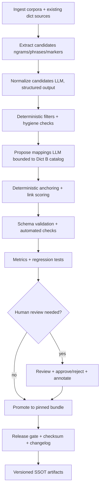
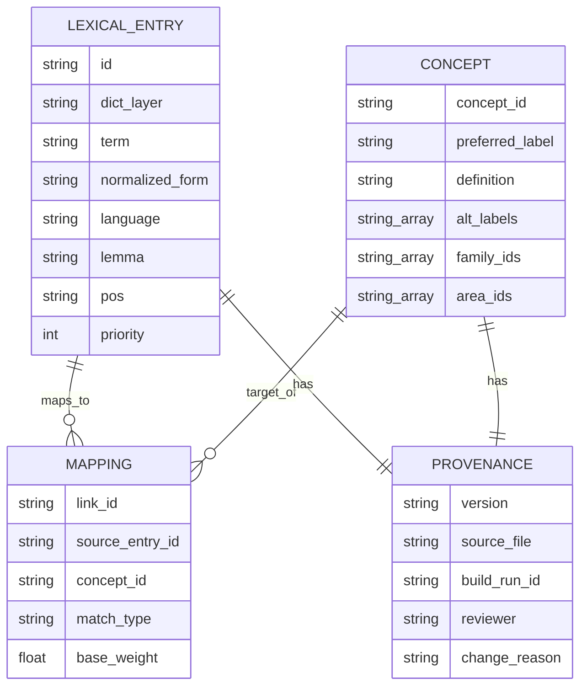

# Dictionary Extraction, Normalization, and LLM‑Bound Calibration for HESPERIA

**Provenance:** External LLM deep-research report, inspecting a snapshot of this repository
(`hesperia-main.zip`). Received/filed 2026-08-03 (Felix, direct operator task — picked out of the
brain repo's `.cache_to_sort_out/` drop, checked against existing docs, saved here since nothing
equivalent existed yet).

**Verification note (Felix, 2026-08-03):** the report's central concrete claim — that
`assets/calibration/dicts/v0_6_0_clr_v052_5/dict_b.jsonl` repeats the same ~283 unique
`concept_id` values across many more rows rather than being a clean SSOT — was checked directly
against the live file: **62,316 total rows, 283 unique `concept_id` values.** The claim is
accurate. The rest of the report (schema proposal, validation strategy, LLM-calibration guardrails,
prompt templates, effort estimates) is **preserved as a dated external proposal, not yet
implemented and not yet reviewed/ratified** — treat it the same way `docs/publication/`'s
Upcelerator material is treated: real input worth keeping, not a claim that any of it is current
architecture or an accepted roadmap item.

**Known artifacts of the source tool, not resolvable here:** inline `citeturnN searchN` markers
and `sandbox:/mnt/data/...` download links throughout the body are byproducts of the original
report-generation session and do not resolve to anything in this repo or externally — read them as
"this claim had a citation once," not as working references.

---

## Executive summary

This research inspected the provided system archive (`hesperia-main.zip`) and found a mature, **deterministic lexical–concept pipeline** with three dictionary layers (A/B/C) plus explicit link artifacts and validators. The archive already includes an **LLM-assisted calibration pipeline** designed as an *offline proposal instrument* (normalization + concept proposal) with deterministic anchoring and schema validation to keep runtime behavior auditable and bounded.

Key findings and conclusions:

- The archive is a **Python-first** repository with heavy emphasis on governance/specs/tests and multiple "pinned" dictionary bundles. The text encoding across parsed text assets is overwhelmingly **UTF‑8** (binary files are limited to a handful of office/binary formats).
- A current calibration bundle is present at `assets/calibration/dicts/v0_6_0_clr_v052_5/` containing:
  - `dict_a.jsonl` (≈10k lexical marker rows, largely RU with some EN),
  - `dict_c.jsonl` (≈24k phrase rows with a `language` field and a RU/EN/mixed split),
  - `links.jsonl` (≈34k explicit A→B and C→B link rows),
  - `dict_b.jsonl` (≈62k rows) which appears to repeat the same ~283 concept rows many times (identical duplicates), suggesting this file is a *calibration catalog dump* rather than a clean SSOT.
- A cleaner concept SSOT exists in `assets/data/engine_dynamics_v060/dict_b/…` with **~283** unique concept rows and richer metadata (alt labels, anchors, etc.).
- For normalization and interoperability, the most robust approach is to treat the system as three record types—**LexicalEntry (A/C), Concept (B), Mapping (links)**—under a unified metadata envelope (version, provenance, confidence, audit fields). This matches the spirit of standardized lexical modeling: **LMF** (Lexical Markup Framework) from ISO is a well-known metamodel for computational lexica, and **OntoLex‑Lemon** from the W3C formalizes "semantics by reference" (lexical entries refer to ontology entities).
- Validation should be layered:
  1) schema + deterministic checks (duplicates, collisions, language tagging consistency),
  2) corpus-derived checks (frequency vs priority mismatches, coverage deltas),
  3) external authority checks where licensing allows (e.g., MeSH, ICD‑11 URIs, SNOMED CT IDs, WordNet synsets).
- LLM calibration is viable **only** as an offline proposal stage with strict contracts. Use **Structured Outputs** (JSON Schema enforcement) from OpenAI when possible to reduce format risk.
- Security/privacy: treat corpus text and calibration payloads as potentially sensitive. Follow PII identification and protection guidance (e.g., NIST SP 800‑122) and avoid logging sensitive inputs (OWASP guidance).

Final verdict: **viable with constraints**. The archive already trends toward the correct governance posture (offline calibration, schema validation, deterministic anchoring). The main improvements needed are: (1) an explicit normalized schema across A/B/C/links, (2) systematic dedup/SSOT policy for Dict B, (3) stronger automated gates + evaluation harnesses, and (4) a hardened LLM audit trail with uncertainty thresholds and human checkpoints.

## Archive inventory and component analysis

### What was inventoried

- The archive contains **2,197** zip members total, of which **1,899** are non-directory files (the rest are directories).
- File extensions are dominated by `.py`, `.md`, `.json`, `.txt`, `.yaml`, `.jsonl`.
- Encoding detection over representative content suggests **UTF‑8 for essentially all text assets**, with a small number of binary artifacts (e.g., `.pdf`, `.pptx`, `.docx`, `.xlsx`, `.npy/.npz`).

### Inventory summary table

This is a *role-based* summary (counts are exact from the inventory export; roles are inferred from path + extension):

| Category (inferred) | Typical paths | Common extensions | What it likely does |
|---|---|---|---|
| Code | `core/`, `hesperia/`, `tools/` | `.py`, `.sh` | Engine logic, build scripts, calibration, validators |
| Tests | `tests/` | `.py`, `.md` | Regression tests and fixtures (dictionary and pipeline tests are present) |
| Data / bundles | `assets/`, `lexicon/` | `.jsonl`, `.json`, `.sha256` | Dict A/B/C packs, corpora extracts, calibration artifacts, integrity hashes |
| Schemas | `schemas/` | `.json` | JSON Schemas for Dict A and Dict B and other envelopes |
| Specifications / governance | `specs/`, `docs/` | `.md` | Normative specs, runbooks, release gate notes, policies |
| Config / ops | repo root, workflows | `.yaml`, `.yml`, Dockerfiles | CI workflows, runtime sealing, packaging and policy enforcement |

Note: this table reflects a repo layout snapshot from before the 2026-07-31 root consolidation
(`configs/`, `data/`, `lexicon/`, `schemas/`, `specs/`, `scripts/` were folded into `assets/`/`tools/`
— see `REPO_STRUCTURE_POLICY.md`). Read paths above as historical, not current.

### Where the dictionaries live and what they look like

From inspection, there are two "centers of gravity":

1) **Calibration bundles** (already assembled A/B/C + links), e.g.
   `assets/calibration/dicts/v0_6_0_clr_v052_5/`
   - `dict_a.jsonl`: lexical marker rows with fields like `surface_form`, `normalized_form`, `match_type`, `candidate_concept_ids`, `priority`.
   - `dict_c.jsonl`: phrase rows with `token_count`, `language` (`ru/en/mixed`), and concept candidates.
   - `links.jsonl`: normalized explicit mappings from A and C entries to a `concept_id` with `base_weight` and a link-level `match_type`.
   - `dict_b.jsonl`: "concept rows" but **with heavy duplication** (only ~283 unique `concept_id` values repeated many times). This is a red flag for treating this file as SSOT.

2) **Engine dynamics pinned SSOT sources**, e.g.
   `assets/data/engine_dynamics_v060/`
   - `dict_a/*.jsonl`: multiple Dict A partitions (seed/core/negative/variants/speech, etc.).
   - `dict_b/*.jsonl`: concept dictionary components; one observed file has **~283** concept rows and richer fields (alt labels, related concepts, anchors).
   - corpora under `corpora/…` suggesting RU TFP-focused text extraction/cleaning/alignment.

### Observed language handling

- Dict C includes an explicit `language` field and a script-based retagging mechanism (RU vs EN vs mixed) based on Cyrillic/Latin character counts (fast, deterministic, no external service). This aligns with good governance: language routing can be changed without changing matcher semantics.

For standard language tagging at the schema layer, use **BCP 47** language tags (IETF RFC 5646) as your canonical field representation. For language code families and broader registries, ISO 639 is the stable reference.

## Normalization schema and extraction strategy

### Design goals for a common schema

A "common schema" should do two things at once:

1) Preserve what HESPERIA already encodes (priority, match type, layer ordering, anchors, family/area IDs, versioning).
2) Make dictionary assets interoperable and auditable across releases, while being expressive enough for validation, mapping, and external authority links.

Two widely-cited modeling baselines are relevant:

- **LMF (Lexical Markup Framework)**: an ISO metamodel for lexical databases and machine-readable dictionaries. It exists specifically to support reuse/integration across lexical resources.
- **OntoLex‑Lemon**: a W3C lexicon model built around "semantics by reference," i.e., lexical entries link to ontology entities rather than embedding semantics ad hoc.

Your system already follows "semantics by reference" operationally: A/C lexical rows point (directly or via links) to Dict B concept identifiers; so leaning into OntoLex-like separation is pragmatic, not academic.

### Proposed schema: unified envelope + three record types

Instead of forcing A/B/C into one flat table, use:

- **LexicalEntry** (covers Dict A and Dict C)
- **Concept** (covers Dict B)
- **Mapping** (covers links)

All three share a common *metadata envelope* to support audits and release gates.

#### Common envelope fields (all record types)

| Field | Type | Why it exists |
|---|---|---|
| `record_type` | enum: `lexical_entry` / `concept` / `mapping` | Lets one schema validate heterogeneous records cleanly |
| `dict_layer` | enum: `A` / `B` / `C` / `LINK` | Binds record to the pipeline layer ordering |
| `id` | string | Stable primary key (e.g., `entry_id`, `concept_id`, `link_id`) |
| `version` | string | Pinned release version (already present throughout the repo) |
| `status` | enum: `active`/`deprecated`/`draft` | Enables safe deprecation without deletion |
| `source` | object | `source_file`, optional `source_line`, source bundle name, commit hash |
| `provenance` | object | build run id, tool version, corpus inputs, timestamps, author |
| `confidence` | number 0–1 | Normalized confidence value (see below) |
| `evidence` | object | corpus frequency stats, example contexts, validator outputs |
| `audit` | object | change reason, reviewer, approval ticket, diff hash |

#### LexicalEntry fields (A/C)

| Field | Type | Notes / mapping from observed system |
|---|---|---|
| `term` | string | surface form (`surface_form`) |
| `lemma` | string nullable | may be computed via morphology; Dict A schema already anticipates `lemma` |
| `pos` | string nullable | standardize to UD UPOS (NOUN/VERB/ADJ/…) |
| `language` | BCP 47 string | e.g., `ru`, `en`; store `mixed` as internal label or map to `und` + flags |
| `normalized_form` | string | existing `normalized_form` |
| `variants` | array[string] | transcript variants, spelling variants, paraphrases |
| `definitions` | array[object] | often empty for A/C; can be attached later |
| `examples` | array[object] | corpus snippets with offsets + hash pointers |
| `match` | object | `match_type`, tokenization constraints, negative patterns |
| `priority` | integer | keep as-is; also compute `confidence` via policy (below) |
| `candidate_concept_ids` | array[string] | existing field |

**Confidence policy (recommended):**
- Keep HESPERIA's existing numeric knobs as the "math input" (`priority`, `base_weight`, `specificity_rank`).
- Derive a normalized `confidence` in the *proposal space only*, never as the runtime arbiter:
  - For Dict A priorities (typically 1–10): `confidence ≈ priority / 10`.
  - For Dict C priorities (seen up to ~99): define a conversion policy, e.g. `(min(priority, 100) / 100)`.
  - For link rows: use `base_weight` directly (already 0–1).

This keeps the system deterministic and makes calibration scoring comparable across layers.

#### Concept fields (B)

Dict B is concept identity and structural metadata. That aligns with "concept as SSOT":

| Field | Type | Why it exists |
|---|---|---|
| `concept_id` | string | stable identifier, used across A/C and links |
| `preferred_label` | string | the canonical label |
| `alt_labels` | array[string] | synonyms/variants |
| `definition` | string | canonical gloss/definition |
| `area_ids` / `family_ids` | array[string] | structural aggregation keys |
| `related_concept_ids` | array[string] | graph edges (semantic relations) |
| `exclusion_concept_ids` | array[string] | disjointness / blocking relations |
| `broader_concept_id` / `narrower_concept_ids` | string / array | taxonomy support |
| `resolver_clues` / `disambiguation_notes` | array/string | controlled disambiguation hints |
| `anchors` | object | e.g., hex anchor symbol, registry references |

#### Mapping fields (links)

Mappings should be first-class, not implicit:

| Field | Type | Notes |
|---|---|---|
| `link_id` | string | stable id |
| `source_dict` | `A` or `C` | observed |
| `source_entry_id` | string | points to LexicalEntry id |
| `concept_id` | string | points to Concept id |
| `match_type` | enum | `exact_token`, `exact_phrase`, `fuzzy`, etc. |
| `base_weight` | number 0–1 | observed; calibrator weight |
| `constraints` | object | optional: scope rules, negation sensitivity |
| `justification` | object | optional: evidence/human note; never used at runtime |

### Sample mapping table (10 real entries, abridged)

| record_type | dict_layer | source_id | term | language | normalized_form | match_type | candidate_concept_ids / concept_id | confidence | provenance.version |
|---|---|---:|---|---|---|---|---|---:|---|
| lexical_entry | A | CAL-00002 | пациент | ru | пациент | exact | candidate: TFP_POLARIZATION | 0.5 | v0.6.0-cal |
| lexical_entry | A | CAL-00010 | личность | ru | личность | exact | candidate: B_A1_F20_002 | 0.5 | v0.6.0-cal |
| lexical_entry | A | CAL-04168 | resistance | en | resistance | exact | candidate: B_A10_F12_002 | 1.0 | v0.6.0-cal |
| lexical_entry | A | CAL-29728 | consequence | en | consequence | exact | candidate: TFP_TRANSFERENCE | 1.0 | v0.6.0-cal |
| lexical_entry | C | C_CAL-75346 | значительная доля пограничных | ru | значительная доля пограничных | exact_phrase | candidate: B_A10_F10_004 | 0.99 | v0_6_0_clr_v052_5 |
| lexical_entry | C | C_CAL-75347 | доля пограничных пациентов | ru | доля пограничных пациентов | exact_phrase | candidate: B_A10_F10_004 | 0.99 | v0_6_0_clr_v052_5 |
| lexical_entry | C | C_CAL-17526 | narcissistic patient | en | narcissistic patient | exact_phrase | candidate: TFP_NARCISSISTIC_PERSONALITY | 0.10 | v0_6_0_clr_v052_5 |
| lexical_entry | C | C_CAL-20595 | analytic (split spelling) | en | analytic (split spelling) | exact_phrase | candidate: C-1003 | 0.10 | v0_6_0_clr_v052_5 |
| concept | B | TFP_POLARIZATION | polarization | en | polarization | — | concept_id: TFP_POLARIZATION | — | v0.6.0-tfp-ru-align |
| concept | B | TFP_TRANSFERENCE | transference | en | transference | — | concept_id: TFP_TRANSFERENCE | — | v0.6.0-tfp-ru-align |

Two blunt observations you should treat as engineering requirements:

- **Dict A has many-to-many ambiguity baked in** (the same normalized token maps to multiple candidate concepts across multiple rows). That's not a bug; it's what lexical triggers do. But it requires explicit disambiguation policy (LLM can help propose; math gates must decide).
- **Dict C is cleaner**: observed `normalized_form` values are unique per row and map to a single concept candidate in the sampled pack; this is consistent with "phrase-first" determinism.

## Validation methods, conflict resolution, and automated checks

Validation must be split into (A) deterministic invariants and (B) authority/evidence checks. If you merge these, you'll either block releases unnecessarily or you'll accept silent semantic drift.

### Deterministic validators and automated checks

These checks should run on every build/calibration iteration:

**Structural and schema validation**
- Validate Dict A and Dict B rows against JSON Schema (already present in the repo). This catches missing keys, invalid types, and invalid enums early.
- Add a schema (or at minimum, structural checks) for Dict C and for the link file, so they are not "best effort only."

**Uniqueness and duplication**
- Enforce unique `entry_id` within A and C; unique `link_id` within LINKS.
- For concepts: enforce **unique `concept_id` in the *canonical* Dict B SSOT**, but allow duplicates in derived "catalog dumps" only if they are explicitly typed as such (e.g., `record_type=concept_view`).
  Practical reason: duplicates are easy to miss and they pollute downstream evaluation and diffing.

**Cross-layer consistency**
- Every `candidate_concept_id` referenced in A/C should exist in canonical Dict B.
- Every link target `concept_id` should exist in canonical Dict B.
- Optional but useful: enforce that each A/C entry either (a) has an outgoing link, or (b) is explicitly marked "unlinked by design."

**Lexical hygiene checks**
- Deduplicate "obvious noise" patterns: punctuation-only entries, placeholder fragments, over-short phrases in Dict C (e.g., "s b").
- Tokenization constraints: for Dict C, validate `token_count` matches tokenizer output (deterministic, prevents drift when tokenizer changes).
- POS consistency: for entries with POS assigned, enforce POS is one of the UD UPOS tags.

**Corpus vs dictionary sanity**
- Frequency mismatches: if an entry's corpus frequency is high but its priority is low (or vice versa), flag for review.
- Coverage deltas: "% of corpus tokens/phrases matched by C first, then A," track by release. A sudden drop indicates regression.

### Validation against authoritative sources

Authority validation is domain-dependent. Because the archive indicates RU/EN clinical/psychodynamic vocabulary, you should treat "authoritative source" as a *stack*:

**General English lexical validation: WordNet**
- Princeton WordNet provides a well-known English lexical database organizing words into synsets with definitions and relations.
Use-case: validate English lemma forms, basic POS expectations, synonym clustering sanity checks.

**Biomedical/clinical controlled vocabularies**
- **MeSH** (Medical Subject Headings) is a controlled, hierarchical vocabulary produced by the National Library of Medicine.
Use-case: validate that medical/psychiatric terms exist, obtain preferred headings, record MeSH IDs where applicable.
- **SNOMED CT** is a clinical terminology in which each concept has a unique numeric identifier (the identifier is unambiguous and machine-readable).
Use-case: map clinically codable concepts to SNOMED CT IDs; be explicit about licensing/redistribution constraints. (SNOMED CT licensing is not optional—treat it as a governance gate.)
- **ICD‑11** identifiers can be accessed via the WHO ICD API, which uses URIs as identifiers and exposes them as API endpoints.
Use-case: map diagnosis-like concepts to ICD‑11 URIs for interoperability.
- **UMLS Metathesaurus** is a large multilingual concept database linking concept names and relationships, useful for cross-vocabulary mapping.
Use-case: build "bridge mappings" (term ↔ concept) and detect synonym collisions, while respecting UMLS licensing terms.

### Conflict resolution strategies

Conflicts are inevitable; you need explicit policy:

1) **Concept collision:** Two concepts end up with the same preferred label/definition semantics.
   - Strategy: keep both only if they differ structurally (family/area) *and* resolver clues can deterministically separate them; otherwise merge or split definitions.
2) **Lexical collision:** One lexical form maps to many unrelated concepts (high ambiguity).
   - Strategy: require phrase-first coverage (Dict C) to carve out the high-precision cases; leave residual polysemy in Dict A but attach scope rules and negative patterns.
3) **Authority disagreement:** External sources disagree (e.g., MeSH vs ICD‑11 vs textbooks).
   - Strategy: preserve the source-specific hierarchy as source-specific metadata (similar to how UMLS represents source hierarchies without editing them), but choose one canonical mapping for runtime and record the alternatives in provenance/evidence.

## LLM alignment and calibration design

### What the LLM should and should not do

The only defensible posture is:

- LLM = **proposal engine**
- HESPERIA math + validators + gates = **truth and acceptance**

Good calibration roles for an LLM (bounded, offline):
- Canonicalization/normalization proposals (surface → normalized phrase; variant suggestions).
- Ambiguity flagging (e.g., "пациент" maps to multiple concepts; suggest scope cues).
- Candidate concept assignment proposals **only when constrained** to a known concept catalog (Dict B SSOT) and returned as strict structured data.
- Duplicate clustering suggestions (near-duplicate phrases/markers).

Unsafe roles to delegate:
- Unbounded creation of new concepts without deterministic anchoring/binding rules.
- Silent rewriting of concept topology (broader/narrower relationships) without human review and regression testing.
- Any runtime decision-making.

### Prompt contracts: use JSON Schema enforcement

When using the OpenAI API, prefer **Structured Outputs** (JSON Schema enforced), which is explicitly designed to ensure outputs adhere to your supplied schema.
This is strictly better than "JSON mode" (valid JSON but not necessarily schema-valid) for a calibration pipeline.

### Prompt template: lexical normalization (A/C)

**Goal:** given candidate phrases/markers and minimal metadata, return normalized forms, variants, guessed language tag, and optional lemma/POS.

```text
System:
You normalize lexical items for a deterministic semantic engine.
You must follow the provided JSON schema exactly.
Rules:
- Preserve meaning; remove fillers and purely rhetorical fragments.
- Lowercase unless a proper noun.
- Do not invent diagnoses or new concepts.
- If uncertain, return uncertainty flags rather than guessing.

User (schema + payload):
SCHEMA: { ... LexicalNormalizeOutput JSON Schema ... }
PAYLOAD:
[
  {"row_id":"A:CAL-00002","text":"пациент","match_type":"exact","priority":5},
  {"row_id":"C:C_CAL-75346","text":"значительная доля пограничных","match_type":"exact_phrase","priority":99}
]
```

**Expected output (example)**

```json
{
  "items": [
    {
      "row_id": "A:CAL-00002",
      "source_text": "пациент",
      "language": "ru",
      "normalized": "пациент",
      "lemma": "пациент",
      "pos": "NOUN",
      "variants": ["пациенты", "пациентка"],
      "uncertainty": {"level": "low", "notes": []}
    },
    {
      "row_id": "C:C_CAL-75346",
      "source_text": "значительная доля пограничных",
      "language": "ru",
      "normalized": "значительная доля пограничных",
      "lemma": null,
      "pos": null,
      "variants": [],
      "uncertainty": {"level": "medium", "notes": ["phrase is fragment; cannot lemmatize safely without context"]}
    }
  ]
}
```

POS tags above are UD UPOS tags, which provide a standard coarse-grained set used across languages.

### Prompt template: concept mapping (A/C → B)

**Goal:** choose (or rank) concept IDs from a *bounded catalog* (Dict B SSOT) and produce structured mapping proposals.

```text
System:
You map lexical items to a controlled concept catalog for a deterministic semantic engine.
You MUST only use concept_ids provided in the catalog.
Return strict JSON matching the schema.
If the mapping is ambiguous, return multiple candidates with confidence and an explanation.

User:
CATALOG (subset):
- TFP_TRANSFERENCE: "transference" — перенос ранних объектных отношений...
- TFP_POLARIZATION: "polarization" — колебание между крайними полюсами...
- B_A10_F10_004: "Разрывы альянса — аспект 3" — ...
ITEMS:
[
  {"row_id":"A:CAL-00002","text":"пациент","language":"ru","context":null},
  {"row_id":"C:C_CAL-75347","text":"доля пограничных пациентов","language":"ru","context":null}
]
```

**Expected output (example)**

```json
{
  "mappings": [
    {
      "row_id": "A:CAL-00002",
      "ranked_concepts": [
        {"concept_id":"TFP_POLARIZATION","confidence":0.35,"reason":"generic clinical noun; appears as marker in the system"},
        {"concept_id":"TFP_TRANSFERENCE","confidence":0.20,"reason":"possible therapy context but no cue"}
      ],
      "decision": {"status":"needs_review","reason":"insufficient context; generic term"},
      "uncertainty": {"level":"high","failure_modes":["polysemy","missing_context"]}
    },
    {
      "row_id": "C:C_CAL-75347",
      "ranked_concepts": [
        {"concept_id":"B_A10_F10_004","confidence":0.80,"reason":"phrase includes 'borderline patients' and matches known phrase entry"}
      ],
      "decision": {"status":"propose_link","reason":"high-specificity phrase"},
      "uncertainty": {"level":"low","failure_modes":[]}
    }
  ]
}
```

### Evaluation metrics and iterative workflow

You need two evaluation layers:

**Mapping quality metrics (offline, supervised where possible)**
- Precision / recall / F1 against a gold mapping set (even if small). This is standard in ontology alignment evaluation (OAEI uses these families of metrics across tracks).
- Top‑k accuracy (does the true concept appear in top 3?).
- Coverage: percentage of corpus spans resolved to concepts without falling back to "unknown".
- Stability: how often does a mapping flip between releases with no upstream dictionary change?

**System behavior metrics (release gates)**
- Noise ratio: unmatched tokens, "too many hits" bursts, concept entropy spikes.
- Dominant-area stability: area/family distributions should not swing wildly unless intentionally changed.
- Regression suite pass rate: pinned test corpus and fixtures must remain stable.

**Iterative workflow (recommended)**
1) Extract corpus evidence → build candidates.
2) LLM normalize candidates (strict schema).
3) Deterministic filtering + de-dup + hygiene checks.
4) LLM proposes mappings / canonical forms (bounded to catalog).
5) Deterministic anchoring / linking math (hard thresholds).
6) Generate diffs + validation reports.
7) Human review for all low-confidence or high-impact changes.
8) Promote into pinned SSOT bundle → run full tests → release.

## Governance, logging, audit trails, and security/privacy

### Audit trail requirements

For every LLM-assisted change, record:

- Input hash (payload digest), not necessarily raw payload.
- Prompt template version, schema version, model name, temperature, max tokens.
- Output JSON + schema validation result.
- Deterministic gate outputs (scores, thresholds, accept/reject).
- Human review decisions (who/when/why).
- Final diff artifact and rollback pointer.

This is essential because exact reproducibility of LLM outputs is never guaranteed; your goal is not perfect replay, but complete traceability and reversibility.

### Handling PII and proprietary data

Assume the corpus could contain PII or sensitive clinical text.

- NIST SP 800‑122 provides practical guidance on identifying PII and selecting protections.
- GDPR's legal text defines "personal data" broadly; treat anything linkable to an individual as in-scope.
- Logging: OWASP guidance is blunt—avoid inserting sensitive data into logs and redact if logging is unavoidable.

### Using the OpenAI API in a privacy-aware way

Important operational facts from OpenAI's own documentation:

- The OpenAI platform describes **abuse monitoring logs** that may retain prompts/responses for up to 30 days by default (subject to controls/eligibility).
- OpenAI's enterprise privacy commitments describe that business users own inputs/outputs and that data is not used for training by default (subject to product terms).

Practical mitigations:
- Redact or pseudonymize personal names/identifiers before sending text off-box.
- Prefer sending *minimal spans* (phrases) rather than full documents.
- Store only hashed exemplars in audit logs; keep raw text in restricted storage with short retention.

## Deliverables, timeline, resources, risks, and diagrams

### Final artifacts to produce

1) **Normalized dictionary bundle**
   - `lexical_entries.jsonl` (A + C normalized into LexicalEntry schema)
   - `concepts.jsonl` (B SSOT concepts, deduped by `concept_id`)
   - `mappings.jsonl` (links as Mapping schema)
   - `bundle_manifest.json` (versions, checksums, build tooling versions)

2) **Mapping tables**
   - A↔B mapping table (token/marker mappings)
   - C↔B mapping table (phrase mappings)
   - Optional bridges to external ontologies (MeSH/SNOMED/ICD‑11/WordNet)

3) **Validation reports**
   - schema validation report
   - duplicate/collision report (lexical + concept)
   - coverage and regression metrics report
   - authority cross-check report (where applicable)

4) **LLM calibration assets**
   - prompt templates (normalize, map, ambiguity audit, dedup clustering)
   - JSON Schemas for all LLM outputs
   - evaluation harness + metric definitions
   - run logs + audit trail format

5) **Change log**
   - human-readable release notes
   - machine-readable diff log (added/changed/removed records)
   - rollback plan (prior bundle pointers + checksums)

### Effort and timeline estimates (ranges)

Assumptions:
- Existing codebase already has parts of the calibration loop and validators.
- Goal is production-grade governance: diffable, reversible, release-gated.

| Phase | 1 engineer/linguist | 2 engineers/linguists | 3 engineers/linguists |
|---|---:|---:|---:|
| Inventory + extraction + SSOT policy (B dedup, link integrity) | 3–6 days | 2–4 days | 2–3 days |
| Unified schema design + migrations | 5–10 days | 3–7 days | 3–5 days |
| Deterministic validators + gates (duplicates, POS, coverage) | 7–14 days | 5–10 days | 4–8 days |
| LLM prompts + structured output schemas + harness | 7–14 days | 5–10 days | 4–8 days |
| Gold set creation + evaluation metrics | 7–21 days | 5–14 days | 5–12 days |
| Hardening: logging, audit trails, security controls | 5–10 days | 3–7 days | 3–6 days |
| **Total** | **5–11 weeks** | **4–8 weeks** | **3–7 weeks** |

Reality check (opinionated): if you don't build a small gold set, you're flying blind. The time you "save" will be paid back as semantic drift and arguments later.

### Resource needs

Compute/storage:
- CPU-only is sufficient for extraction, schema validation, n‑gram stats, and diff/report generation.
- Storage: plan for multiple pinned bundles + corpora snapshots; ballpark 5–50 GB depending on corpus size and how many releases you retain.
- For language/POS tagging: you may add external taggers (UD-based) which increases runtime in the build pipeline, not engine runtime.

API usage:
- Normalization calls scale with number of candidate rows and batch size.
- Mapping calls scale with ambiguous cases + catalog size (keep catalogs compact per request).

### Risks, limitations, mitigations

| Risk | Why it matters | Mitigation |
|---|---|---|
| Semantic drift via LLM suggestions | Small changes accumulate and silently change system behavior | Hard gates, low temperature, bounded catalogs, mandatory diffs + test regressions; LLM never runs in production runtime |
| Over-normalization | LLM strips meaning ("aggressive filler removal" can delete signal) | Keep source_text, require reversible mapping, add "meaning loss" heuristics, human review on high-impact entries |
| Concept collapse / synonym merge errors | Wrong merges destroy interpretability | Require external evidence + human approval for merges; track collision metrics; keep exclusions/notes |
| Duplicated concept catalogs (observed) | Pollutes evaluation and can hide real diffs | Enforce SSOT concept uniqueness; treat repeated catalogs as derived views |
| Privacy leakage in logs/prompts | Clinical text can contain PII | Redaction, avoid logging payloads, short retention, follow NIST/OWASP guidance |
| Licensing traps (SNOMED/UMLS) | You can't redistribute what you don't own | Treat licensing as a build gate; store only permitted identifiers/links; document constraints |

### Suggested Mermaid diagrams

Workflow (build → calibrate → gate → release):



Entity relationship model (LexicalEntry/Concept/Mapping + provenance):



### Final verdict

**Viable with constraints.** The archive already implements the right philosophical stance (LLM-assisted calibration as a bounded offline instrument, not runtime semantics). Your next steps should be conservative and boring:

- Formalize the unified schema and SSOT rules (especially for Dict B).
- Add deterministic validators for duplicates/collisions/frequency sanity.
- Use OpenAI Structured Outputs for schema enforcement and never accept low-confidence outputs without review.
- Treat privacy, logging, and licensing as gates—not "later."
