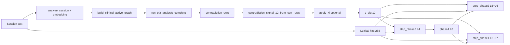

<!--
Gena — TRIZ / session graph → field dynamics. Analysis of wiring (what’s new, how it flows).
-->

# Gena — dynamics integration analysis (TRIZ → L4/L5/L6/L7)

**Owner lens:** session → clinical graph → **TRIZ complete** → area-level **contradiction drive** consumed by `hesperia.extensions.dynamics`.  
**Related:** [GENA-OPEN-WORKFLOW-PROCEED.md](GENA-OPEN-WORKFLOW-PROCEED.md) · [ETHAN-OPEN-WORKFLOW-PROCEED.md](ETHAN-OPEN-WORKFLOW-PROCEED.md) · [E2E_RUN_ORDER.md](../../E2E_RUN_ORDER.md) · [HESPERIA_VARIABLE_CATALOG.md](../../HESPERIA_VARIABLE_CATALOG.md)

---

## 1. What’s new (vs early Gena log)

| Addition | Role |
|----------|------|
| **Ξ proxy** (`xi_proxy.py`) | After base `c_sig`, optional **per-area boost** from TRIZ row topology (scores + `area_a`/`area_b`). Feeds stronger L7 drive where contradictions localize. |
| **`HESPERIA_FIELD_DYNAMICS_XI` / `XI_SCALE`** | Toggle and scale for Ξ proxy; artifact exposes `xi_proxy_global`, `xi_scale` inside `triz_contradiction_meta`. |
| **Phases 2–4 on same `c_sig`** | One boosted `c_sig` drives Phase 3 hex pressure, Phase 2 family pressure, Phase 1 area `p_a`. |
| **Registry v0.5** | `xi_scale` documented alongside family/hex/L8 knobs. |

Unchanged core: **fetch path** still builds active graph from session text, runs `run_triz_analysis_complete`, returns `contradictions` rows.

---

## 2. Wiring diagram (logical)



**Note:** When Phase 3 is off, stack skips L4; `c_sig` still flows to L5/L6 or L6-only. When **TRIZ** is off (`HESPERIA_FIELD_DYNAMICS_TRIZ=0`), `c_sig` is all zeros — dynamics still runs on **hit injection** only.

---

## 3. Module map (Gena touchpoints)

| Step | Module | Function |
|------|--------|----------|
| Session → graph | `hesperia.engine.kme.clinical_bridge` | `build_clinical_active_graph` |
| TRIZ | `hesperia.extensions.triz.pipeline` | `active_graph_from_payload`, `run_triz_analysis_complete` |
| Topology maps | `runtime.pipeline.run_e2e_all` | `_activation_topology_maps` (shared with E2E) |
| Rows → L7 vector | `hesperia.extensions.dynamics.triz_signal` | `contradiction_signal_12_from_con_rows` |
| Ξ boost | `hesperia.extensions.dynamics.xi_proxy` | `apply_xi_to_contradiction_signal` |
| Orchestration | `hesperia.extensions.dynamics.e2e_bridge` | `run_field_dynamics_e2e_artifact` |
| Entry from runner | `runtime.pipeline.run_e2e_all` | Optional 10th artifact when `HESPERIA_FIELD_DYNAMICS=1` |

---

## 4. Contradiction row contract (for dynamics)

Dynamics + Ξ proxy consume rows shaped like TRIZ output:

| Field | Use |
|-------|-----|
| `score` | Clamped [0,1]; summed per area; drives `c_sig` normalization and Ξ global/local weights |
| `area_a`, `area_b` | Preferred area indices 0..11 |
| `area_cluster` | Fallback list of areas if a/b missing |

If parsing fails or graph empty: `rows == []`, `triz_meta` may carry `triz_note` or `_error`.

---

## 5. Environment flags (Gena-relevant)

| Variable | Effect |
|----------|--------|
| `HESPERIA_FIELD_DYNAMICS=1` | Enables dynamics step + artifact |
| `HESPERIA_FIELD_DYNAMICS_TRIZ=0` | Skip TRIZ fetch; `c_sig = 0`, `triz_skipped` in meta |
| `HESPERIA_FIELD_DYNAMICS_XI=0` | Skip Ξ boost; base `c_sig` only |
| `HESPERIA_FIELD_DYNAMICS_XI_SCALE` | Max per-area boost scale (default 0.14) |

Phase flags (Phase2/3/4) only change **which layers** consume the same `c_sig`; they do not change TRIZ wiring.

---

## 6. Artifact fields (observability)

`run_output_e2e_field_dynamics.json` includes:

- **`contradiction_signal_12`** — final drive after Ξ (what phases used).
- **`triz_contradiction_meta`** — `contradiction_count`, optional `triz_note` / `_error`, plus **`xi_proxy_global`**, **`xi_scale`** when Ξ applied.

Use these to verify TRIZ → dynamics in CI or demos without opening state JSON.

---

## 7. Gaps / next integration work

1. **Full Ξ from KME graph** — Current Ξ is TRIZ-row proxy only; future: tension from concept graph statistics.  
2. **Dedicated TRIZ→dynamics unit test** with mocked rows (beyond `test_field_dynamics_triz_signal` / xi tests) if CI needs zero full TRIZ stack.  
3. **Observability** — Structured logging for contradiction_count vs final `c_sig` norm (product task).

---

## 8. Full E2E — all deliverables (steps 1–10, full dynamics stack)

One run: sentence + L1–L9 + R1–R4 + sphere math + domain metrics + **session KME** + **TRIZ complete** + session topology + **field dynamics** (Phases 2–4, TRIZ bridge, Ξ when contradiction rows exist).

```bash
# From repo root (or use ./tools/e2e_full_deliverables.sh)
HESPERIA_FIELD_DYNAMICS=1 \
HESPERIA_FIELD_DYNAMICS_PHASE2=1 \
HESPERIA_FIELD_DYNAMICS_PHASE3=1 \
HESPERIA_FIELD_DYNAMICS_PHASE4=1 \
HESPERIA_FIELD_DYNAMICS_TRIZ=1 \
HESPERIA_FIELD_DYNAMICS_XI=1 \
python3 -m runtime.pipeline.run_e2e_all \
  --out-dir assets/artifacts/e2e_full_deliverables \
  --text "Your clinical or rich session text here."
```

**Script:** `tools/e2e_full_deliverables.sh` — same env; optional args: `[OUT_DIR] [text...]`.

**Outputs:** 10 JSON files + `field_dynamics_state.json` in the chosen out-dir. Step 10 shows `dynamics_phase: 4` and `dynamics_stack: L4+L8+L5+L6` when all phase flags are set.

**Note:** If the session graph has **no active nodes**, TRIZ returns zero rows → `c_sig` stays zero; L4/L8 still run on **lexical hits**. Use text that activates the clinical graph for non-empty `triz_contradiction_meta` / Ξ fields.

---

## 9. Lighter / CI paths

```bash
# Dynamics without TRIZ (hits only, faster)
HESPERIA_FIELD_DYNAMICS=1 HESPERIA_FIELD_DYNAMICS_TRIZ=0 python3 -m runtime.pipeline.run_e2e_all ...
```

See [E2E_RUN_ORDER.md](../../E2E_RUN_ORDER.md) for artifact order and paths.
