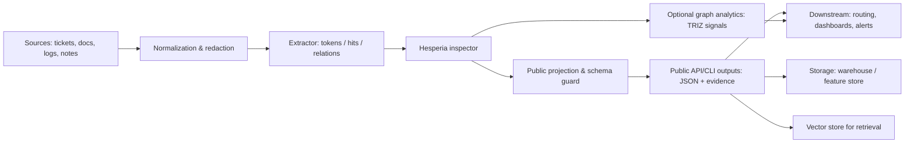
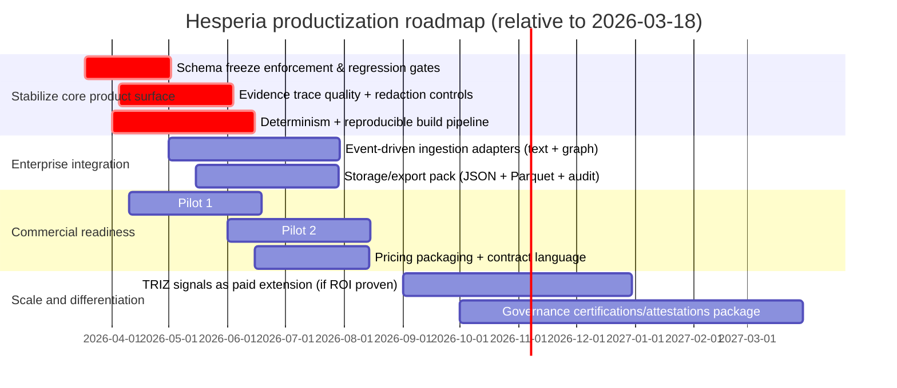

# Hesperia RAD Deep Research Report

## Executive summary

Hesperia (in the provided RAD archive) is best understood as a **deterministic structural inspection and placement engine**: it takes **text** (and, for some subsystems, a **concept graph**) and returns a **placement** into a fixed set of **macro “domains” and policy “families”**, accompanied by **evidence**, **confidence/trust signals**, and a **sealed, public-safe projection** that is designed to be productized without leaking internal mechanics.

What makes Hesperia commercially interesting is not “smart text generation,” but the opposite: a **repeatable, auditable, schema-frozen mapping** from messy language into **stable real‑world classes** that can drive downstream workflows (triage, routing, guardrails, compliance checks, dashboards, change detection, and decision intelligence). That structure-first stance is aligned with what modern governance and regulation increasingly expects: documentable boundaries, predictable behavior, and traceability.

This report synthesizes (a) what the archive shows Hesperia already is (definitions, boundaries, deployment surfaces) and (b) how to place it into real systems and future markets using current standards and adjacent platforms’ patterns.

**Explicit exclusion:** the archive contains a **TFP (Transference-Focused Psychotherapy / Kernberg) testing domain** and related assets; this report **treats that entire TFP layer as non-product test collateral** and excludes it from the definition of “Hesperia capabilities,” except where relevant as an example of a domain plug‑in boundary.

## Definition, scope, and boundaries of Hesperia

### Current definition in operational terms

From the archive, Hesperia is a **deterministic semantic/structural analyzer** with a product boundary deliberately designed around:

- **Public entrypoints** (CLI + HTTP API) that accept *text* and return **public-safe structured outputs**.
- An internal pipeline that computes multi-stage **structural metrics**, performs **topology-aware propagation**, applies **guards** (invariants / governance checks), and emits a stable **fingerprint/report**.
- A **projection layer** that enforces a strict public vocabulary and strips reserved/internal indices before anything leaves the sealed runtime. (This “projection then serialize” discipline directly aligns with the idea that “method may be proprietary, but evidence and reproducibility must exist.”)

In blunt terms: Hesperia is a “**placement inspector**” for text. It is designed to answer: *what structural region does this text land in, how strongly, and what evidence makes that placement defensible?*

### What Hesperia outputs, concretely

The archive contains a frozen public JSON output schema that includes:

- **macro-domain vector** (fixed length) and **policy-family counts** (fixed length),
- dominant macro-domain / policy-family,
- propagated variants of the above,
- scalar metrics (entropy/coverage/tension/loopability/confidence),
- **trust tier** and **evidence entries** (matched span + label + confidence band + location).

This output choice is product-sane because it supports:
- indexing/search (vectors),
- routing/triage (dominants + trust tier),
- governance (evidence + audit manifest),
- compatibility guarantees (frozen schema).

### “Inspection for placement” and the system-class boundary

Hesperia’s “placement” can be interpreted as **mapping language into system classes** across two axes:

1. **Macro domains (10 public)**: high-level class buckets suitable for dashboards and coarse routing.
2. **Policy families (240 public)**: finer-grained classes whose activation counts support measurement, comparison, and change detection.

Internally, the archive enforces a **10+2 model**: 10 public-operational “areas” plus 2 reserved/service areas, and a corresponding split between public families and reserved families. That split is part of the product boundary: reserved indices exist to prevent the public surface from becoming reverse-engineerable. This is directly consistent with the general security principle of minimizing exposed internal state.

### Topology and why it matters to placement

The archive specifies an **icosahedral surface graph** topology (12 areas, degree 5). Conceptually, that means Hesperia’s “placement” is not purely a flat classification; it also supports **controlled neighbor spread** (propagation) over a fixed adjacency structure. That capability is useful when real-world classes are not independent (which is almost always).

A visual mental model helps here:

This topology-aware spread is also a direct bridge to established graph methods: diffusion/propagation, community structure, and bounded traversal are standard ways to stabilize noisy local evidence into a coherent global signal.

### Layered capabilities (excluding TFP)

The archive’s pipeline order (L1–L10) describes a staged capability stack that, in practical product language, can be summarized as:

- **Attribution & coverage**: what was matched vs not, and how concentrated the signal is.
- **Traversal / activation structure**: reach/loops/cluster behavior of activated elements.
- **Shadow / correction**: compare baseline vs “shadow” structure and gate acceptability.
- **Topology and propagation**: map to area/family, propagate across neighbors, compute correction.
- **Math gates and dynamism**: enforce numerical/geometry-style constraints, compute stability/trajectory measures.
- **Trust and governance**: convert signals into trust tiers / decision statuses (guard-checked).
- **Interpretation layer**: translate structural state into flags used by downstream packaging.

### TRIZ subsystem as an adjacent-but-coherent product line

The archive includes a “TRIZ layer” positioned as **decision intelligence analytics** over an active semantic graph:

- detects **typed contradictions** and classifies patterns,
- scores **innovation clusters** using community detection (Louvain-style clustering is explicitly referenced in the archive),
- tracks narrative propagation metrics.

This matters commercially because it turns placement into **actionable strategic signals** (contradiction index, innovation pressure, narrative penetration) rather than a static classification.

The Louvain method is a well-known heuristic optimization approach for community detection, and it is documented and published in the network science literature.

TRIZ itself has an established literature describing it as a structured approach to inventive problem solving grounded historically in large patent analyses.

### Hard boundaries and non-claims

The archive is explicit (especially in its limitations docs for TRIZ-style outputs) that Hesperia’s outputs are **structural signals**, not proof of factual truth. Productization should keep these boundaries crisp:

- Not a truth engine; it does not verify real-world facts.
- Not a replacement for expert judgment in high‑stakes domains.
- Performance is bounded by upstream extraction quality and by the corpus you feed it.
- Signals reflect representation; they do not become “objective reality.”

This boundary language is also defensible against modern governance/regs: many regimes care less about whether a system is “AI” in marketing terms and more about whether it affects decisions, rights, safety, and accountability.

## Real-world problem fit and use cases across domains

Hesperia’s core utility is strongest where you need **repeatable classification + evidence + stable metrics** to run an operational loop. Below are concrete use cases by domain, phrased as “problem → how Hesperia helps → what you ship.”

### Manufacturing and industrial operations

A common pain point in manufacturing is that **quality events, nonconformance reports, corrective actions, and shift logs** are text-heavy and classification is inconsistent.

Hesperia can provide:
- **deterministic routing** of incident descriptions to macro domains/families (e.g., process, materials, safety policy families),
- **change detection**: “this line’s defect narratives are drifting structurally,” using vector deltas and stability metrics,
- **audit-ready evidence traces**: for why an event was categorized the way it was.

This supports KPIs like reduced triage time, fewer misrouted CAPAs, and earlier detection of systemic failure patterns—without relying on non-repeatable model behavior.

### Logistics and supply chain

Supply chains generate semi-structured text at scale: exception messages, partner communications, customs notes, delivery incident reports. The hard part isn’t “summarization,” it’s getting a **stable class signal** that drives workflow.

Hesperia can:
- normalize “exception narratives” into a stable class vocabulary,
- compute **propagated structural spillover** (neighbor influence), which is useful when disruptions cascade,
- provide a **trust tier** so low-confidence placements can be routed to human review rather than silently acted upon.

This pattern is aligned with risk-managed automation: you automate high-trust cases, escalate low-trust cases, and measure drift over time.

### Healthcare and life sciences

Healthcare documentation (clinical notes, adverse event narratives, patient complaints) is high sensitivity. The value proposition must be governance-first.

Hesperia can be positioned as:
- a **classification/mapping layer** for routing and operational analytics,
- an **evidence trace** generator for supervised review,
- a deterministic engine supporting audits and repeatability.

But deployment here must treat protected health information and regulated uses seriously; the HIPAA privacy framework emphasizes safeguards and limits on use/disclosure for PHI.

The safe play is to start with **de-identified or operational text** (SOP deviations, quality events, labeling complaints) rather than direct clinical decisioning, until governance maturity is proven.

### Education and workforce training

Education organizations have a classification problem disguised as a content problem: curriculum alignment, policy compliance, student support tickets, and course feedback.

Hesperia can:
- map policies and curriculum text into stable domains/families,
- track drift (“this course’s outcomes are shifting structurally across semesters”),
- generate audit packs for accreditation or internal governance.

Because the output is a stable schema, it also works as a backbone for analytics dashboards and longitudinal comparisons.

### Urban planning and public sector operations

Urban planning and municipal ops typically involve:
- long comment periods (public feedback),
- policy documents,
- incident narratives (311/911 notes, maintenance logs).

The value is not generative writing; it’s **consistent categorization + evidence** and the ability to monitor structural change over time.

In the EU context, any system influencing decisions in sensitive public-sector contexts should be designed with the current AI regulatory frame in mind, especially where risk classification and transparency obligations may apply depending on use.

### Robotics and cyber-physical safety

Robotics deployments generate logs and operator narratives that must be triaged quickly: near-miss reports, safety incidents, environmental condition notes.

Hesperia can:
- turn operator text into stable classes for trend analytics,
- gate automation through trust tiers,
- serve as an input to safety case documentation rather than a black-box classifier.

This aligns with “auditability over cleverness”—a safer default for cyber-physical systems.

### Software systems, security, and compliance

This is arguably the cleanest early market: software organizations already live in tickets, runbooks, incident reports, and policy docs.

Hesperia can:
- classify incidents into stable categories,
- detect structural drift in postmortems (warning sign of systemic change),
- provide evidence-backed routing for SOC/IR workflows,
- generate public-safe audit manifests (version, checksum, evidence count), supporting traceability.

API security guidance emphasizes controlling authorization, resource consumption, and sensitive business flows—areas where Hesperia’s sealed-runtime posture and explicit rate limiting fit naturally.

## Integration points and enterprise workflow patterns

Hesperia is easiest to integrate when you treat it as a **bounded classification/inspection microservice** plus a **feature-producing batch tool**, not as a monolithic platform.

### Typical integration surfaces

**Inputs (upstream):**
- raw text (documents, tickets, notes),
- extracted entities/relations assembled into an “active graph” for higher-order analytics (TRIZ/KME-style), where you already have an extraction pipeline.

**Outputs (downstream):**
- JSON outputs conforming to a stable schema (OpenAPI-described),
- evidence traces for UI review,
- vectors suitable for indexing (vector DB, search, analytics stores),
- audit manifests/checksums for governance.

**Storage and retrieval:**
The archive references a vector search backend pattern (Chroma) for retrieval workflows. Chroma’s own docs position it as an open-source “search engine”/vector database, with a production hosted option, making it a plausible default for an early product integration.

If you choose that path, you’re implicitly relying on standard ANN indexing concepts; HNSW is a widely cited approach for approximate nearest neighbor search.

### Enterprise workflow patterns that fit Hesperia

**Pattern: triage + escalation**
- Call Hesperia on incoming text.
- If trust tier ≥ threshold: auto-route (queue, handler, policy flow).
- Else: send to human review with evidence trace.

This reduces false confidence and matches risk frameworks that emphasize governance and human oversight for higher-impact decisions.

**Pattern: drift monitoring**
- Store macro-domain vectors over time.
- Track divergence from baseline profiles (per team/system/site).
- Trigger “review required” when drift exceeds threshold.

This looks like classic statistical process control, but on semantic structure.

**Pattern: compliance-ready reporting**
- Emit public audit manifest (version + checksum + evidence count).
- Store alongside downstream decisions to support audit trails.

This lines up with modern expectations for traceability and accountability in automated decision-support systems.

### Integration flow diagram

This diagram uses Mermaid’s standard flowchart syntax.

## Deployment architecture and technical requirements

### Deployment modes that match the archive

The archive supports two pragmatic packaging models:

**Sealed CLI binary**
- Suitable for air-gapped, on-prem, or “ship-to-evaluator” environments.
- The archive references compilation/bundling approaches (e.g., onefile/standalone builds). Nuitka explicitly supports creating standalone/onefile executables from Python applications.

**Containerized HTTP API**
- FastAPI-style service boundary with Bearer auth and OpenAPI 3.x shape (as per archive design intent).
- OpenAPI is explicitly meant to describe HTTP APIs in a language-agnostic way for both humans and machines.

### API and schema contracts

For productization, treat these as non-negotiable:

- **OpenAPI contract** for all public endpoints.  
- **JSON Schema** (Draft 2020-12) for response validation and compatibility gates.  
- **Stable schema versioning**: changes require explicit surface version bumps.

These are the same compatibility mechanics used by mature API ecosystems; they’re boring—and that’s a feature.

### Data formats and storage

**Runtime payloads**
- JSON for requests/responses (schema-validated).
- Evidence trace objects (span + label + confidence band).
- Optional active-graph JSON for graph analytics features.

**Analytics storage**
- For batch analytics and offline processing, columnar storage formats (e.g., Parquet) are standard in enterprise pipelines; the Parquet format is defined and maintained as an open specification.

This matters because placement outputs (vectors + metrics + evidence counts) are a clean fit for time-series monitoring and BI.

### Determinism, auditability, and sealing

The archive’s “RAD freeze” posture uses mechanisms that map directly onto modern traceability expectations:

- Schema freezing and output determinism.
- Artifact checksums and manifests.
- Optional cryptographic timestamping of canonical specs: OpenTimestamps provides a client to create and verify timestamp proofs anchored to the Bitcoin blockchain.

The security posture should treat determinism as an operational requirement:
- pin dependency versions,
- fix serialization ordering,
- isolate tenants and runs,
- ensure projection is mandatory for any public output.

## Productization and market fusion strategy

### What Hesperia is “in the market,” honestly

Hesperia is not trying to win on generic NLP breadth. Its defensible wedge is:

- **Deterministic placement into stable classes**
- **Evidence traces**
- **Trust tiers / governance gating**
- **Sealed runtime + projection to prevent leakage**
- Optional “decision intelligence” overlays (TRIZ signals) for strategy and monitoring

That package fits buyers who care about **repeatability** and **auditability** more than “best possible F1 on a benchmark.”

### MVP feature set

A product MVP that respects the archive’s architecture should be:

- **Text analyze** endpoint (single + batch) returning:
  - macro-domain vector + policy-family counts,
  - dominant class IDs,
  - evidence trace,
  - trust tier + confidence + a small set of interpretable scalars.
- **Compare** endpoint:
  - structural divergence score,
  - delta vectors,
  - “what changed” evidence slices.
- **Audit manifest**:
  - version/build,
  - schema version,
  - checksum,
  - evidence count.

Add TRIZ as a paid extension only after you have baseline retention and you can prove it drives decisions (not just “interesting charts”).

### Business models and pricing

Given open-ended constraints, the realistic models are:

**Usage-based API (SaaS)**
- price per “document analyzed” with tiers by volume and max document length,
- premium for higher rate limits / dedicated tenancy.

**Enterprise subscription (SaaS or managed private)**
- annual contract, priced by:
  - number of tenants/projects,
  - included throughput,
  - compliance package (audit retention, dedicated support).

**On-prem / air-gapped license**
- yearly license + maintenance,
- priced by node count or throughput envelope.

This is consistent with how buyers purchase inspection/analytics engines: throughput + governance + support, not “token counts.”

### Go-to-market strategy

A practical GTM sequence:

1. **Security/compliance and software operations** (fastest feedback, text-native, strong ROI).
2. **Industrial quality / manufacturing ops** (high value, deterministic audit angle).
3. **Regulated documentation workflows** (healthcare/life sciences) once governance maturity is credible.

### Market fusion: where Hesperia plugs into bigger ecosystems

The best “fusion” framing is: **Hesperia as an ontology-grounded inspection layer that can feed enterprise semantic layers**.

Modern decision platforms emphasize an “ontology/semantic layer” that unifies data, logic, actions, and security. Public documentation from enterprise ontology platforms describes that concept explicitly: ontology objects/links plus workflows and security.

Hesperia can fuse into that world as:
- a **classifier/inspector** producing stable object tags and evidence,
- a **feature generator** for semantic search and workflow automation,
- a **governance gate** (trust tier) controlling when automated actions should fire.

Separately, it can fuse into the rapidly growing retrieval ecosystem as:
- structured features stored in a vector DB (Chroma-style) for retrieval and monitoring.

### KPIs and success metrics

To productize Hesperia, measure what matters operationally:

- **Determinism rate**: identical input → identical output (hash match).
- **Coverage**: matched_tokens / total_tokens (or equivalent).
- **Evidence usefulness**: reviewer acceptance rate of top‑k evidence entries.
- **Automation eligibility**: % outputs above trust threshold (by customer + domain).
- **Drift sensitivity**: time-to-detect meaningful structural change vs customer ground truth.
- **Latency and cost per document**: p50/p95 for single and batch runs.
- **Schema stability**: change frequency requiring version bump (should be low).

These align with governance frameworks emphasizing reliability, transparency, and continuous monitoring rather than one-time benchmark wins.

## Risk, legal, ethics, and safety posture

### Operational and security risks

**API exposure and abuse**
- Risks: broken authorization, excessive resource consumption, abuse of sensitive business flows, SSRF, misconfiguration.
- Mitigations: strict authn/authz, rate limits, payload caps, hardened infrastructure, and continuous scanning—directly aligned with the API Security Top 10 risk categories.

**Data leakage**
- Risks: evidence traces exposing sensitive material; logs leaking secrets; internal vocabulary leakage enabling method reconstruction.
- Mitigations: enforce projection/sanitization, strict logging policies, secret management, and automated “forbidden term scans” across public artifacts.

**Garbage-in drift**
- Risks: upstream extraction changes (tokenization, relation extraction) silently distort outputs.
- Mitigations: pinned extractor versions, golden test corpora, output hash regression gates, and profile-based monitoring (baseline vs current).

### Legal and regulatory risks

**EU AI Act exposure**
Even if marketed as “inspection,” if Hesperia is used to influence decisions, it can fall under the EU AI Act’s broad scope for AI systems including logic/knowledge-based approaches, depending on deployment context. You need a classification-by-use approach, not marketing-by-name.

**GDPR**
If outputs are derived from personal data (tickets, HR notes, customer communications), GDPR obligations apply: purpose limitation, data minimization, access controls, retention, and lawful basis.

**HIPAA**
If used on PHI in the US, HIPAA privacy requirements require appropriate safeguards and limit disclosures; this should strongly steer architecture toward PHI minimization, redaction, and audit trails.

### Ethics risks (misclassification and misuse)

The dominant ethical risk is not “hallucination,” but **misclassification with undeserved confidence**, plus secondary misuse as a surveillance classifier.

Mitigation strategy:
- treat trust tier as a *control surface* (automation only above threshold),
- require human review in sensitive domains,
- publish clear non-claims and limitations,
- track disparate impact and error distribution by subgroup where personal data is involved.

### Governance and assurance controls

Adopt a governance stack aligned to recognized management/risk frameworks:

- AI/system risk management: use RMF-style lifecycle controls (map/measure/manage/govern principles).  
- AI management system standardization: ISO/IEC 42001 (AI management systems) is positioned as an organizational management system standard for AI use.  
- Security management: ISO/IEC 27001 as an ISMS standard baseline for production operations.  

Even if you avoid the word “AI,” these frameworks provide a credible compliance story for enterprise customers.

## Pilot experiments, evaluation protocols, roadmap, and competitive landscape

### Recommended pilots and evaluation protocols

A pilot should prove three things: **placement usefulness**, **governance safety**, and **operational ROI**.

**Pilot design template (applies across domains)**  
- **Duration:** 6–10 weeks per domain.
- **Data:** 5k–50k texts (or equivalent), with a curated gold set (500–2,000) labeled by SMEs.
- **Arms:** (A) current workflow baseline vs (B) baseline + Hesperia placement + evidence/trust gating.
- **Logging:** output hashes, audit manifests, reviewer actions, and time-to-resolution.

**Core metrics**
- Determinism: exact match rate across reruns.
- Classification quality: precision/recall/F1 on SME-labeled gold set.
- Coverage and evidence acceptance: % of cases where top‑k evidence is accepted by reviewer.
- Workflow impact: mean triage time reduction; escalation rate; false automation rate.
- Drift detection: sensitivity and specificity of drift alerts vs known change events (policy changes, process changes, incident patterns).

**Evaluation guardrails**
- For any domain involving personal data: enforce GDPR-style minimization and retention, and ensure evidence traces are redacted/controlled.  
- For regulated contexts: document intended use and keep it out of prohibited/high-risk patterns until governance is mature.

### Prioritized roadmap with milestones

The roadmap below assumes “constraints open-ended” but still prioritizes the hard dependencies: stability, governance, and product surfaces.

Mermaid Gantt syntax and date formatting are standardized in Mermaid documentation.

**Milestone interpretation**
- **6 months (by ~2026-09):** stable public API/CLI, pilot-proven value in at least one domain, deterministic build and audit story.
- **12 months (by ~2027-03):** integration adapters + monitoring/drift product, repeatable sales motion, first enterprise contracts.
- **24 months (by ~2028-03):** ecosystem partnerships (semantic layer / workflow platforms), compliance package maturity, optional TRIZ decision intelligence line with evidence of revenue contribution.

### Competitive and adjacent technology comparison

The following are not “same product” competitors in every case; they are adjacent solutions buyers will compare against when shopping for text classification, document understanding, knowledge graphs, or ontology-driven decision platforms.

| Competing / adjacent technology | What buyers use it for | What it does well | Where Hesperia differentiates (if executed well) |
|---|---|---|---|
| Enterprise ontology / decision platforms (e.g. Palantir-class) | Enterprise semantic layer + workflows + operational decisioning | Strong integration story: semantic layer (“ontology”) tying data, logic, actions, and security; interoperability pitch | Hesperia can be the **deterministic placement/inspection sub-layer** feeding a semantic layer; smaller footprint; can be embedded as a component rather than a platform replacement |
| Cloud managed NLP APIs (e.g. AWS Comprehend-class) | Rapid NLP features (classification, entity recognition) via APIs | Fast adoption, cloud-native ops, custom training workflows | Hesperia’s edge is **determinism + sealed projection + topology-aware structural metrics** rather than model training; stronger audit posture if outputs are fixed-schema and reproducible |
| Document understanding / IDP suites (e.g. IBM-class) | Document insight extraction for knowledge workers | Packaging around “intelligent document understanding,” productivity claims, enterprise sales machinery | Hesperia can differentiate by being **a measurable placement engine** (vectors + drift + trust tiers) rather than primarily a search/IDP UI; easier to embed in pipelines if lightweight |
| Graph DBs + graph algorithms (e.g. Neo4j ecosystem) | Knowledge graphs + graph algorithms (community detection, clustering, etc.) | Mature graph algorithm catalog; operational graph database footprint; production-grade community detection capabilities | Hesperia’s differentiator is **text-to-structure placement + public-safe evidence output**; Neo4j requires you to build/maintain the graph and semantics yourself |
| OWL / SPARQL knowledge graphs (e.g. Stardog-class) | Ontology management + reasoning + semantic querying | OWL and rule reasoning; SPARQL query support; aligns with enterprise knowledge graph patterns | Hesperia differentiates by offering a **deterministic inspection engine over raw text/graphs** with fixed placement outputs; Stardog is strongest once you already have curated ontologies and RDF-style assets |
### Practical differentiation statement for Hesperia

A credible, non-hype positioning sentence that fits the archive’s design is:

> **Hesperia is a deterministic structural placement engine that maps text into stable operational classes with evidence and trust tiers, designed for sealed deployment and auditability.**

That’s defensible because it maps directly to: stable schema contracts (OpenAPI/JSON Schema), deterministic output expectations, and governance/frozen surface discipline.

## Sources used

Key primary/official and academic sources referenced inline include: OpenAPI Specification (v3.1.x); JSON Schema Draft 2020-12; NIST AI RMF 1.0 and related roadmap materials; EU AI Act (Regulation (EU) 2024/1689); GDPR (Regulation (EU) 2016/679); HIPAA Privacy Rule overview; ISO/IEC 27001 and ISO/IEC 42001 standard overviews; API Security Top 10 (2023 edition); Chroma documentation; HNSW nearest neighbor search paper; Louvain method and original publication references; TRIZ overview paper; Apache Parquet format spec; Nuitka compiler documentation; Mermaid diagram syntax references.
